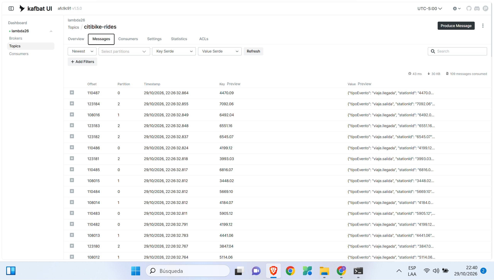
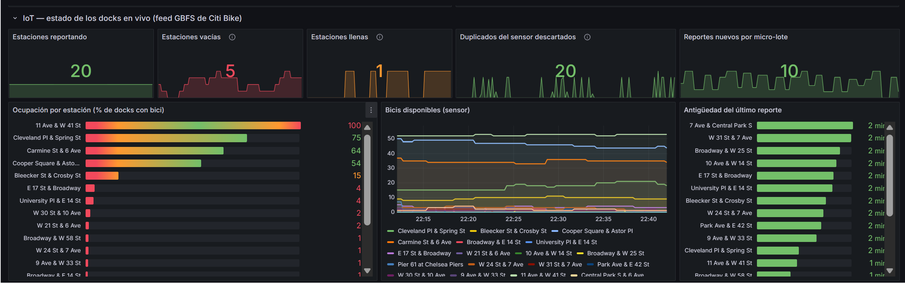
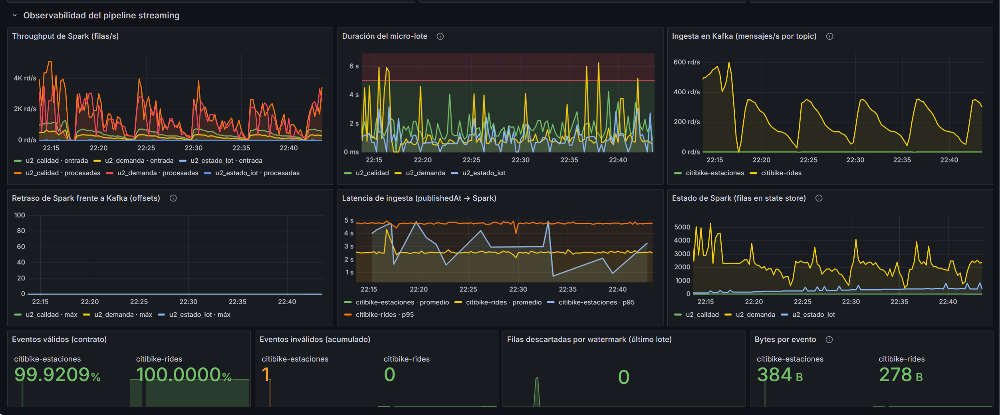
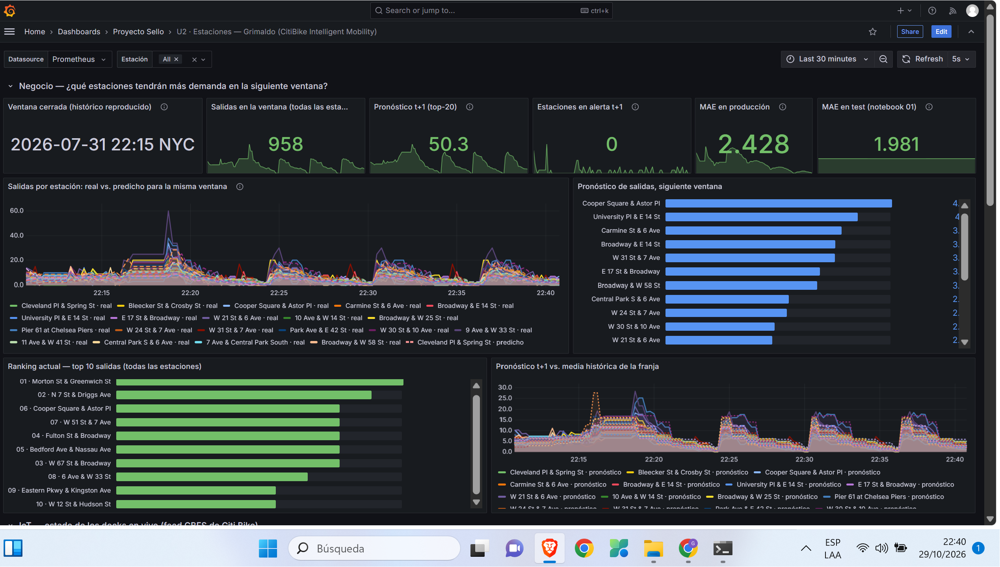

# Producto U2 — Dimensión Estaciones (Grimaldo Arredondo Martinez)

| Campo | Valor |
| :--- | :--- |
| **Proyecto** | CitiBike Intelligent Mobility |
| **Equipo** | Data Geniuses |
| **Integrante** | Grimaldo Arredondo Martinez |
| **Dimensión** | Estaciones: utilización y demanda futura |
| **Producto** | Unidad 2: pipeline en tiempo real con ingesta empresarial e IoT, streaming con Spark, observabilidad/costos y BI/ML |
| **Código** | `lambda26/u2-estaciones/` (productores), `lambda26/pyspark/sesiones/u2-estaciones/` (notebooks), `lambda26/obs/grafana/.../u2_estaciones_grimaldo.json` (tablero) |

> Todos los valores de esta página salen de la corrida real del 29 de octubre de 2026 (notebooks 01 y 02, logs de los productores y el tablero). No se escribieron a mano: se copiaron de las salidas.

## Producto

**Pipeline en tiempo real con ingesta de eventos empresariales e IoT/sensores, procesamiento streaming con Spark, observabilidad/costos y salidas BI/ML distribuidas — aplicado a la dimensión Estaciones.**

Implementa un pipeline Big Data en tiempo real para la dimensión Estaciones de Citi Bike. Integra la ingesta de eventos empresariales (viajes del histórico real reproducidos en `citibike-rides`) y de eventos IoT/sensores (estado de los docks del feed GBFS en `citibike-estaciones`) mediante Kafka. El procesamiento distribuido usa Spark Structured Streaming con ventanas de 15 min, watermark y checkpoint. La observabilidad se hace con Grafana y la estimación de costos operacionales parte del volumen medido. Además, prepara salidas BI/ML distribuidas: reutiliza el corte train/test y la noción de "alta demanda" de U1 en un modelo de series de tiempo, que se infiere ventana a ventana en streaming y pronostica las salidas de cada estación en los próximos 15 minutos.

## 1. Alcance de capacidades por sesión

### 1.1. Pregunta y evolución desde U1

**Pregunta U2 (Brief S2):** *¿Qué estaciones podrían registrar mayor demanda durante la siguiente ventana temporal?*

| | U1 (batch) | U2 (streaming) |
| :--- | :--- | :--- |
| Pregunta | ¿Qué estaciones concentran la demanda y cuáles tienen alta probabilidad de alta utilización **en un día**? | ¿Cuántos viajes saldrán de cada estación **en los próximos 15 minutos**? |
| Granularidad | estación × día | estación × ventana de 15 min |
| Modelo | Clasificación `es_alta_demanda` (P75). Ganador: RandomForest, AUC 0.786 | Regresión sobre la serie (lags + media histórica por franja). Ganador: **LinearRegression** (MAE 1,9805 en test, mejor que la media histórica: 2,1231) |
| Salida | Notebook con ranking y métricas | Tablero Grafana en vivo: ranking actual, observado vs. predicho, pronóstico t+1 y estado de los docks |
| Lo que se reutiliza | — | Esquema explícito, reglas Silver, el mismo corte train/test (2026-07-24) y la idea de "alta demanda" como alerta |

### 1.2. Arquitectura de la dimensión (capa de velocidad de Lambda)

```
CSV Citi Bike (U1) ─ producer_rides_replay ─► Kafka citibike-rides ───────┐
                                                                          ├─► Spark Structured Streaming ─► Pushgateway ─► Prometheus ─► Grafana
Feed GBFS en vivo ── producer_gbfs_estaciones ► Kafka citibike-estaciones ┘     u2_demanda · u2_estado_iot · u2_calidad · monitor
```

**Tabla 1. De la sesión a la capacidad de mi dimensión**

| Sesión | Capacidad | Cómo la implementa mi dimensión |
| :--- | :--- | :--- |
| S6 | Eventos empresariales | `citibike-rides`: cada viaje del histórico real se publica como `viaje.salida` y `viaje.llegada`, en orden cronológico, con `stationId` como key |
| S7 | Eventos IoT/sensores | `citibike-estaciones`: estado de los docks (sensores de anclaje) desde el feed GBFS en vivo, enlazado con los IDs del histórico |
| S8 | Streaming con Spark | Ventanas de 15 min por estación, watermark de 10 min, checkpoint; deduplicación de reportes del sensor con `dropDuplicatesWithinWatermark` |
| S9 | Observabilidad y costos | Throughput, duración de micro-lote, retraso de offsets, latencia, válidos; costo mensual a partir del volumen medido |
| S10 | Series de tiempo e inferencia | Modelo global para las 20 estaciones top, comparado contra baselines e inferido en vivo ventana a ventana |
| S11 | BI/ML distribuido | Tablero con KPIs en vivo y la predicción en la misma vista, junto al MAE en producción |
| S12 (esta evaluación) | Ensambla todo y lo sustenta | Pipeline completo de mi dimensión (2 productores → Kafka → 3 consultas Spark → Pushgateway/Prometheus → tablero Grafana), sustentado con esta página, los notebooks 01-02 y la demo en vivo |

### 1.3. Criterio 1 — Ingesta de eventos empresariales (Kafka)

- **Contrato:** `u2-estaciones/CONTRATO_U2.md` §1. Topic `citibike-rides`, 3 particiones, key `stationId`.
- **Fuente:** el día `2026-07-28` (período de prueba, posterior al corte de entrenamiento) reproducido con `SPEEDUP = 60`.
- **Volumen reproducido:** **266 435** eventos (salidas + llegadas) desde las 06:00, con 591 viajes descartados por calidad. Línea `loaded` de `rides.log`:

```json
{"service": "u2-estaciones", "component": "producer-rides", "status": "loaded", "archivos": 5, "replayDate": "2026-07-28", "desdeHora": 6, "eventos": 266435, "descartadosCalidad": 591}
```
- **Evidencia:** Kafka UI con los mensajes de `citibike-rides`. La key de cada mensaje es el `stationId` y los eventos se reparten entre las 3 particiones.



### 1.4. Criterio 2 — Ingesta IoT / sensores

- **Fuente:** feed GBFS `station_status` de Citi Bike. Los números de bicis y docks disponibles vienen de los sensores de anclaje de cada estación, y `last_reported` es la hora del reporte del dispositivo.
- **Esquema ajustado:** el `station_id` UUID del feed se enlaza con el `short_name` del histórico, para que ambos topics usen la misma key. Resultado en `gbfs.log`: `"enlazadas": 20, "enlazadasPor": {"short_name": 20}, "sinEnlace": []`.
- **Volumen ajustado:** solo las 20 estaciones del modelo, cada 30 s (≈ 0,67 ev/s).
- **Verificación:** reportes repetidos del sensor deduplicados en Spark: **54** duplicados descartados en los últimos micro-lotes (notebook 02 §8.2), y el reporte inyectado ×3 quedó en **1** fila. Evento con `bicisDisponibles = -3` contado como inválido (`citibike-estaciones`: 1 inválido; 99,92 % válidos en el tablero).
- **Hallazgo:** 2 de las 20 estaciones top (`6876.04` y `6912.01`, en Central Park South) aparecieron fuera de servicio en el feed real (0 bicis, 0 docks), así que el panel de ocupación muestra 18 barras.
- **Evidencia:**



### 1.5. Criterio 3 — Procesamiento streaming (ventanas, watermark, checkpoint)

| Elemento | Implementación | Evidencia en vivo |
| :--- | :--- | :--- |
| Ventanas | `window(eventTime, "15 minutes")` por `stationId`, sobre el tiempo del evento | Ventana `2026-07-28 09:45` NYC: 1.º W 21 St & 6 Ave (14 salidas), 2.º S 2 St & Kent Ave (12), 3.º Washington St & Gansevoort St (10) |
| Watermark | 10 min sobre `eventTime`; modo `append` | Viaje inyectado 2 h tarde → `numRowsDroppedByWatermark = 1` (§8.2) |
| Checkpoint | `artifacts/checkpoints/{demanda,estado_iot,calidad}` | `demanda`: 37 en `offsets/`, 36 en `commits/`; `offsets/36` → `{"citibike-rides":{"0":25617,"1":26349,"2":29335}}`; reinicio con `REINICIAR = False` retoma sin reprocesar |
| Deduplicación | `dropDuplicatesWithinWatermark(["stationId","timestamp"])` sobre `publishedAt` (15 min) | Mismo reporte ×3 → 1 fila en `stream/estado_iot` |

### 1.6. Criterio 4 — Observabilidad

Tablero **U2 · Estaciones — Grimaldo**, fila "Observabilidad":

- Throughput de entrada vs. procesado por consulta. Si procesado ≥ entrada, Spark mantiene el ritmo.
- Duración del micro-lote frente al trigger de 5 s.
- Retraso frente a Kafka (`maxOffsetsBehindLatest`) y tasa de ingesta por topic (kafka-exporter).
- Latencia de ingesta (promedio y p95), eventos válidos e inválidos, filas descartadas por watermark y estado de Spark.

**Correlación observada** (promedios en Prometheus; 3 min a 60x, últimos 90 s a 120x):

| Métrica (`u2_demanda`) | `SPEEDUP = 60` | `SPEEDUP = 120` |
| :--- | ---: | ---: |
| Ingesta en Kafka, `citibike-rides` (msg/s) | 371,3 | 472,9 |
| Entrada de Spark (filas/s) | 373,4 | 498,6 |
| Duración del micro-lote, promedio (ms) | 982 | 2 585 |
| Duración del micro-lote, máximo (ms) | 1 418 | 5 940 |
| Filas en el state store | 2 473 | 3 624 |
| Retraso frente a Kafka (offsets, máx.) | 0 | 0 |

Al subir `SPEEDUP` de 60 a 120, la entrada pasó de 373 a 499 filas/s y la duración del micro-lote de 982 a 2 585 ms en promedio, con picos de 5,9 s **por encima del trigger de 5 s**. El retraso de offsets se mantuvo en 0. La ingesta no se duplicó (×1,27 ya en Kafka) porque las dos mediciones cubren franjas históricas distintas (06-11 h y 11-17 h). Ver `U2_hallazgos.md` §3.



### 1.7. Criterio 5 — Costos y criterios de escalado

Calculado en el notebook 02 (§10) con el volumen medido por `u2_calidad`:

| Topic | Bytes/evento | ev/s del sistema real | GB/día | GB en Kafka (7 d) |
| :--- | ---: | ---: | ---: | ---: |
| `citibike-rides` | 278,0 | 6,42 | 0,143 | 1,004 |
| `citibike-estaciones` (todo el sistema, ~2.200 estaciones cada 30 s) | 383,5 | 73,33 | 2,263 | 15,842 |

Costo mensual estimado: **US$ 92,76/mes** = US$ 91,10 de cómputo (3 × t3.medium × 730 h) + US$ 1,66 de almacenamiento (72,19 GB/mes de Parquet crudo, cota superior) (precios de referencia de S9, AWS us-east-1).

**Escalado:** se agrega cómputo a Spark cuando la duración del micro-lote supera el trigger de forma sostenida. Se agregan particiones cuando el retraso de offsets crece. Pasar de 20 a 200 estaciones mantiene **un solo modelo global** y solo multiplica las filas de inferencia por micro-lote.

### 1.8. Criterio 6 — Salidas BI

Fila "Negocio" del tablero: salidas de la última ventana, ranking top 10 de todas las estaciones, real vs. predicho por estación, pronóstico t+1 y **estaciones en alerta** (pronóstico ≥ 1,5 × la media histórica de la franja). Este último KPI conecta con la "alta demanda" de U1.



### 1.9. Criterio 7 — Series de tiempo validadas

**Validación offline (notebook 01, test desde 2026-07-24):**

| Modelo | RMSE | MAE | R² |
| :--- | ---: | ---: | ---: |
| Baseline persistencia | 3,7468 | 2,4977 | 0,4503 |
| Baseline media histórica | 3,1973 | 2,1231 | 0,5997 |
| **LinearRegression (ganador)** | **2,9492** | **1,9805** | **0,6594** |
| GBTRegressor (60 árboles) | 2,9576 | 1,9845 | 0,6575 |

LinearRegression le gana a los dos baselines: un RMSE 21,3 % menor que la persistencia y un MAE 6,7 % menor que la media histórica. GBT queda prácticamente empatado con LinearRegression, así que se eligió el modelo más simple.

**Validación en producción (notebook 02 §9.2):** **200** predicciones comparadas con la ventana real (10 ventanas × 20 estaciones). MAE en producción = **2,784** (RMSE 3,727) frente a MAE en test = **1,980**. El error en vivo es 41 % mayor y se concentra en las estaciones de más demanda de la punta de la mañana (`5712.03`: MAE 4,63). Con más ventanas, el MAE en vivo del tablero bajó a 2,43 (captura de la fila Negocio). Ver `U2_hallazgos.md` §4.

Integrado al tablero BI: el MAE en producción y el MAE en test se ven lado a lado en la fila "Negocio".

### 1.10. Hallazgos y decisiones

- **Ceros explícitos:** sin la malla estación × ventana completa, los lags saltan sobre las ventanas sin viajes y el modelo aprende una serie que no existe.
- **Watermark de la telemetría sobre `publishedAt`:** con `last_reported`, una estación cuyo sensor lleva rato sin reportar se descartaría como dato tardío.
- **Tiempo del evento histórico:** las ventanas usan la hora original del viaje. Los paneles de Grafana usan la hora de publicación. Por eso el tablero muestra la ventana reproducida como texto ("2026-07-28 09:00 NYC").
- **Limitación:** `citibike-rides` es un día histórico reproducido y `citibike-estaciones` es el estado actual. Se muestran juntos, pero no se cruzan en un mismo KPI porque no son del mismo momento.
- **Estaciones top fuera de servicio:** `6876.04` y `6912.01` reportan 0 bicis y 0 docks en el feed real. La ocupación queda indefinida y no se publica (18 barras de 20).
- **Recrear el productor reinicia el replay detrás del watermark:** para la prueba a 120x, el replay arrancó en la hora 11 (`REPLAY_START_HOUR`), ya que desde las 06:00 todo habría sido dato tardío.
- **MAE en producción > MAE en test** (2,784 frente a 1,980): arranque en frío de los lags y una sola franja del día evaluada.
- **`StackOverflowError` al detener `u2_calidad` (§11):** las consultas se detuvieron bien, pero el hilo dejó una traza de `java.util.regex` cuyo origen no se ve. Causa no identificada; los resultados no se ven afectados.
- Detalle completo (síntoma, diagnóstico, solución y lección) en `lambda26/u2-estaciones/U2_hallazgos.md`.

## 2. Rúbrica de evaluación

**Tabla 2. Rúbrica de evaluación de la Unidad 2 (autoevaluación de mi dimensión)**

Escala: A = 20, B = 15, C = 10, D = 5 puntos. Cada nivel se justifica con la evidencia de la sección 1 de esta página.

| Criterio | Peso | CE / Nivel | Descriptor del nivel A (20 pts) | Autoevaluación | Evidencia (sección 1) | Peso × Puntos |
| :--- | ---: | :--- | :--- | :---: | :--- | ---: |
| 1. Ingesta de eventos empresariales mediante Kafka | 12% | — (apoyo) | Eventos empresariales publicados y consumidos en vivo, con contrato de evento y tópico documentados. | **A** | §1.3: contrato `CONTRATO_U2.md` §1, topic `citibike-rides` con 3 particiones y key `stationId`; 266 435 eventos publicados (`rides.log`); consumidos por Spark (`offsets/36` con los offsets de las 3 particiones); captura de Kafka UI. | 240 |
| 2. Ingesta de eventos IoT/sensores | 10% | — (apoyo) | Eventos IoT/sensores integrados al mismo pipeline, con esquema y volumen ajustados y verificados. | **A** | §1.4: esquema ajustado (UUID GBFS → `short_name`, 20/20 enlazadas, misma key que `citibike-rides`); volumen ajustado (20 estaciones cada 30 s, ≈ 0,67 ev/s); verificado con 54 duplicados descartados, reporte ×3 → 1 fila y el evento inválido contado (99,92 % válidos). | 200 |
| 3. Procesamiento streaming con Spark Structured Streaming | 14% | — (apoyo) | Ventanas, *watermarking* y *checkpointing* verificados en vivo sobre datos reales del pipeline. | **A** | §1.5: ventanas de 15 min con ranking real de la ventana 09:45; viaje 2 h tarde → `numRowsDroppedByWatermark = 1`; checkpoint con 37 `offsets/` y 36 `commits/` y reinicio con `REINICIAR = False` sin reprocesar. | 280 |
| 4. Observabilidad con métricas y tableros | 12% | — (apoyo) | Panel de observabilidad operativo con métricas correlacionadas del pipeline streaming. | **A** | §1.6: fila "Observabilidad" del tablero; correlación medida entre `SPEEDUP` 60 y 120 (entrada 373 → 499 filas/s, micro-lote 982 → 2 585 ms con picos de 5,9 s sobre el trigger de 5 s, retraso de offsets en 0). | 240 |
| 5. Estimación de costos y criterios de escalado | 8% | — (apoyo) | Estimación de costos y criterios de escalado documentados y justificados frente al volumen real del pipeline. | **A** | §1.7: bytes/evento medidos por `u2_calidad` (278,0 y 383,5), GB/día y retención de 7 d; US$ 92,76/mes desglosado; escalado atado a métricas observadas (micro-lote vs. trigger, retraso de offsets). | 160 |
| 6. Salidas BI/ML distribuidas | 12% | CE044-N3 | Tablero BI con KPIs del flujo en tiempo real, verificado en vivo. | **A** | §1.8: fila "Negocio" en vivo con salidas de la última ventana, ranking top 10, real vs. predicho, pronóstico t+1 y estaciones en alerta; captura del tablero. | 240 |
| 7. Series de tiempo o inferencia en streaming documentada y validada | 12% | CE043-N3 (completa) | Modelo o inferencia de series de tiempo validado con métricas, integrado al tablero BI (criterio 6). | **A** | §1.9: LinearRegression con MAE 1,9805 en test, mejor que los dos baselines; validación en producción con 200 predicciones (MAE 2,784, brecha explicada); MAE en producción y en test lado a lado en el tablero. | 240 |
| 8. Sustentación | 20% | CG | Sustenta con claridad y profesionalismo su aporte individual, respondiendo con precisión las preguntas del jurado. | **A** (objetivo) | Se califica en vivo. Cómo cubro cada subaspecto: Tabla 3. | 400 |
| **Total** | **100%** | | | | | **2 000** |

**Nota final** = suma de (`Peso` × `Puntos de la calificación obtenida`) / 100 × 20.

Con los pesos en % y los puntos en escala de 20, la suma da 2 000 sobre un máximo de 2 000 (100 × 20). Normalizada, la nota es 2 000 / (100 × 20) × 20 = **20,00 / 20**.

> El criterio 8 lo pone el jurado. Si lo califica B (15 pts), la suma baja a 1 900 y la nota a **19,00 / 20**. Los criterios 1-7 dependen solo de evidencia que ya está en esta página.

**Tabla 3. Subaspectos de la sustentación (Unidad 2) y cómo los cubro**

| Subaspecto | Qué observa en Unidad 2 | Cómo lo cubro |
| :--- | :--- | :--- |
| 1. Aporte individual | Cada integrante demuestra su propia dimensión U2, no el trabajo del resto del equipo. | Sustento solo la dimensión Estaciones: mis productores (`u2-estaciones/`), mis notebooks 01-02, mi tablero `u2_estaciones_grimaldo.json` y esta página, todo en mi rama `u2-estaciones-grimaldo`. |
| 2. Comunicación y orden | Claridad, estructura, tiempo y lenguaje técnico durante la presentación. | Sigo el orden de esta página: pregunta → arquitectura → criterios 1 a 7 con su evidencia → hallazgos. Uso los términos del pipeline (watermark, checkpoint, micro-lote, MAE). |
| 3. Presentación personal y actitud | Puntualidad, vestimenta limpia y adecuada, higiene, cabello ordenado, actitud profesional, respeto, honestidad y coherencia con los valores y principios cristianos de la institución. | Se observa en la sustentación. En honestidad, la página reporta también lo que no salió como se esperaba: MAE en producción 41 % mayor, micro-lote sobre el trigger a 120x, `StackOverflowError` sin causa identificada. |
| 4. Repositorio y estándares | Topics académicos vigentes, organización, commits y reproducibilidad del pipeline streaming. | Código separado por función (productores, notebooks, tablero), contrato de eventos (`CONTRATO_U2.md`), commits convencionales (`feat`/`docs`/`chore`), PR desde rama propia, checkpoint y `REINICIAR` para repetir la corrida, y `U2_hallazgos.md` con síntoma, diagnóstico y solución. |
| 5. MkDocs o equivalente | Documentación de tu dimensión U2 publicada, navegable y alineada con `u2-producto.md`. | Esta página está en la navegación del sitio (`mkdocs.yml`), compila con `mkdocs build --strict` y sigue la estructura de la plantilla: Producto, 1. Alcance (Tabla 1), 2. Rúbrica (Tablas 2 y 3) y 3. Trazabilidad. |
| 6. Pitch/demo ejecutiva | Introducción breve de cómo evolucionó tu dimensión desde Unidad 1, con apoyo visual (.pptx, Canva o equivalente). No reemplaza la demo técnica de la Tabla 2 de S12, la precede. | Abro con la tabla U1 → U2 (§1.1): de clasificación diaria con RandomForest (AUC 0,786) a pronóstico cada 15 min en vivo. Sigo con el diagrama de arquitectura (§1.2) en apoyo visual, y después paso a la demo del tablero. |

## 3. Trazabilidad

Los criterios 1-7 son cita literal de los criterios de evaluación del producto de la Unidad II en el sílabo de Big Data. El criterio 8 (Sustentación) corresponde a la sustentación exigida por el mismo sílabo (sesión 12, actividad 2).

| Criterio | Competencia / Nivel | Evidencia en mi dimensión |
| :--- | :--- | :--- |
| 6. Salidas BI/ML distribuidas (S11) | **CE044-N3** ("Analiza y Define Estrategias"): visualiza la predicción de un modelo junto a KPIs del negocio en la misma sesión distribuida. | §1.8: la fila "Negocio" muestra el pronóstico t+1 y las estaciones en alerta junto a los KPIs en vivo (salidas de la ventana, ranking top 10). |
| 7. Series de tiempo (S10) | **CE043-N3** ("Genera Modelos"), segunda mitad. La primera mitad (primer modelo entrenado y comparado) ya se evidenció en U1 con el RandomForest de `es_alta_demanda`. | §1.9: modelo de series de tiempo comparado contra dos baselines, validado offline y en producción, e integrado al tablero. |
| 1-5. Kafka, IoT, streaming, observabilidad, costos (S6-S9) | — (apoyo): no son evidencia de nivel de CE042, CE043 ni CE044. | §1.3 a §1.7: la infraestructura que hace posible la evidencia de los criterios 6 y 7. |
| 8. Sustentación (S12) | CG: Competencia General "Investigación e Innovación". Transversal, no forma parte de ninguna competencia CD/IA. | Tabla 3. |
