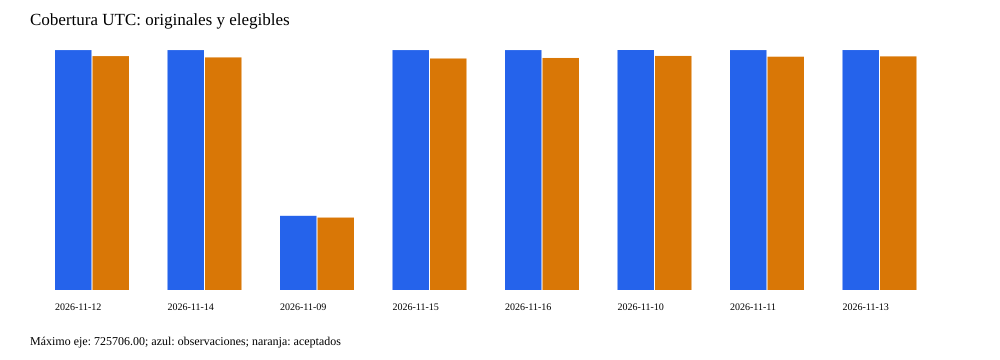
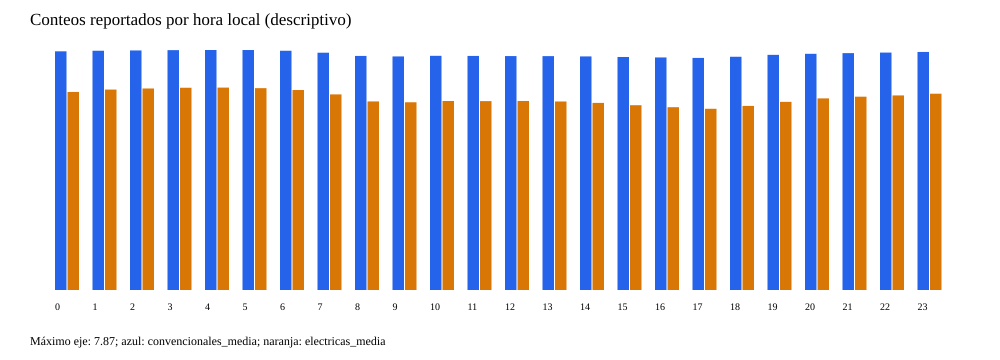

# Cobertura y calidad del histórico ampliado

Evidencia de lectura/Silver/EDA de la ejecución `20261117T171917344468Z`. Los resultados de modelos se informan aparte; no se deducen de esta descripción.

## Originales e integridad

2.121 archivos, 149.089.863 bytes (142,18 MiB). La descarga incorporó 1.831 pendientes y omitió los 290 previos; segunda pasada: 0 descargas y 2.121 omitidos. Los 290 SHA-256 preliminares se mantuvieron. Inventario, manifiesto incremental, ambos resúmenes y auditoría de entrada están en `reports/descargas/`, fuera de Git. No se escribe en Supabase.

El rango incluye un tramo del 9/11/2026 y siete días UTC con 288 capturas, 10–16/11. La descripción de abajo incluye el contexto parcial; no equivale al periodo aceptado para entrenar. Las fronteras inicial/final no se completan con observaciones inventadas.

| Fecha UTC | Archivos de estado | Registros | Estaciones | Elegibles Silver | Discrepancia total/tipos |
|---|---:|---:|---:|---:|---:|
| 2026-11-09 | 89 | 224280 | 2520 | 219008 | 11784 |
| 2026-11-10 | 288 | 725706 | 2520 | 707762 | 27067 |
| 2026-11-11 | 288 | 725472 | 2520 | 705447 | 29329 |
| 2026-11-12 | 288 | 725472 | 2519 | 707303 | 19381 |
| 2026-11-13 | 288 | 725588 | 2520 | 706442 | 16184 |
| 2026-11-14 | 288 | 725472 | 2519 | 703335 | 21159 |
| 2026-11-15 | 288 | 725472 | 2519 | 700031 | 22209 |
| 2026-11-16 | 288 | 725472 | 2519 | 701628 | 23233 |

La discrepancia de esta tabla es solo `q_discrepancia_total`, no la unión de todos los indicadores. Los estratos de evaluación Gold también consideran diferencias convencionales/eléctricas y el instante futuro; sus denominadores son pares de predicción, no las filas de esta tabla.

## Cadencia y estaciones

Cadencia medida con timestamps de captura y con last_updated interno del feed:

```json
{
  "delta_archivo_s_min": 293.82800006866455,
  "delta_archivo_s_max": 304.7339999675751,
  "delta_archivo_s_p50_p95": [
    300.00299978256226,
    301.35199999809265
  ],
  "delta_feed_s_min": 238,
  "delta_feed_s_max": 363,
  "delta_feed_s_p50_p95": [
    300,
    302
  ]
}
```

Huecos interiores por estación: `{"huecos_interiores_gt450s": 0, "max_intervalo_s": 304.734}`. No hay saltos interiores >450 s en los intervalos observados. Esto no niega ausencia antes de aparecer o después de desaparecer una estación, ni acredita un estado físico continuo entre snapshots.

Cobertura por estación: `{"estaciones": 2522, "min_capturas": 323, "max_capturas": 2105, "min_elegibles": 0, "p50_p95_elegibles": [2105, 2105]}`. Los identificadores con menor cobertura se conservan en analisis/resumen.json; no se rellenan sus faltantes.

## Calidad aplicada y reconciliación

| Conjunto | Filas |
|---|---:|
| Entrada | 5302934 |
| Aceptados Silver | 5150956 |
| Excluidos completos | 151978 |

| Estado del registro | Aceptado | Filas |
|---|---|---:|
| activo | True | 5150956 |
| activo | False | 178 |
| inactivo | False | 151800 |

Las 151.800 observaciones inactivas no se tratan como cantidades cero ni como errores estructurales. Las otras 178 observaciones activas incumplen reglas de elegibilidad: sus motivos exactos quedan en las columnas por objetivo. No se atribuye automáticamente toda exclusión a un mismo motivo. No hay una categoría estructuralmente inválida en este resumen.

La lectura de vuelta reconcilió conteos, tipos y multiconjuntos, incluidas multiplicidades. Razones superpuestas no se suman como registros descartados. Se mantienen las reglas Silver v2, sin reinterpretar los conteos por discrepancias. El RDD de categorías de calidad se reconcilió contra DataFrame; no elimina observaciones.

## Descripción de cantidades elegibles

```json
{
  "distribuciones": {
    "convencionales": {
      "n": 5150956,
      "min": 0,
      "max": 85,
      "media": 7.7406038801340955,
      "p25_p50_p75_p95": [
        1,
        5,
        11,
        26
      ]
    },
    "electricas": {
      "n": 5150956,
      "min": 0,
      "max": 114,
      "media": 6.302659739279465,
      "p25_p50_p75_p95": [
        1,
        3,
        8,
        25
      ]
    }
  },
  "ceros": {
    "convencionales": {
      "observaciones_cero": 839964,
      "estaciones_con_cero": 1561
    },
    "electricas": {
      "observaciones_cero": 1002896,
      "estaciones_con_cero": 2243
    }
  },
  "episodios": {
    "convencionales": {
      "episodios": 19033,
      "max_s": 631192.9839999676,
      "p50_p95_s": [
        2399.9249999523163,
        49799.91200017929
      ]
    },
    "electricas": {
      "episodios": 60904,
      "max_s": 451499.7569999695,
      "p50_p95_s": [
        1201.8759999275208,
        20700.18800020218
      ]
    }
  }
}
```

Los episodios de cero miden duración entre primera y última observación elegible de una secuencia; no añaden un intervalo ni demuestran falta física continua. Igualdad del conteo entre dos instantes tampoco demuestra ausencia de viajes o movimientos intermedios.

El calendario analítico es America/New_York. Los cortes son UTC: train 10–13 incluye desde lunes 9 a las 19:00 locales hasta viernes 13 a las 19:00; validación UTC 14 mezcla viernes por la noche y sábado; prueba UTC 15–16 mezcla sábado por la noche, domingo y lunes. No se equiparan esas fechas locales con dos días UTC completos.

Los gráficos son agregados pequeños. Diferencias horarias y diarias pueden reflejar composición de estaciones, calidad o actividad; este único ciclo no establece causas ni estacionalidad.




