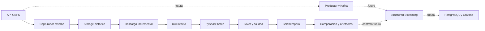

# Propuesta de actualización de la dimensión de Jose Miguel

Esta es una propuesta para acordar con el equipo. No sustituye silenciosamente
el brief común ni cambia las dimensiones de Harry, Grimaldo o Cristhian.
El trabajo anterior `Dim-Duracion-de-viajes` se conserva como antecedente.

## Pregunta central que se conserva

> ¿Cómo analizar y anticipar la demanda y el comportamiento operativo de los viajes
> de Citi Bike NYC a partir de información histórica y eventos procesados en tiempo
> real, para apoyar el monitoreo y la planificación del sistema de movilidad compartida?

Disponibilidad se vincula con comportamiento operativo, monitoreo y planificación:
es el inventario reportado que condiciona la posibilidad de iniciar un viaje.
No es número de viajes ni demanda; no reemplaza los indicadores de los compañeros.
Devoluciones, redistribución, mantenimiento y cambios en los reportes también pueden
alterar el inventario. La relación con demanda no se infiere restando stocks.

## Adición propuesta a fuentes del dominio, sin reemplazar las compartidas

Para la dimensión de Jose Miguel se añade el histórico GBFS de station_status,
station_information y vehicle_types, capturado externamente y conservado como
JSON gzip en Supabase Storage, bucket citibike-raw. Los CSV de viajes siguen siendo
la fuente de las dimensiones que los utilizan. Un snapshot no es un viaje ni
aporta información personal de usuarios. No se agregan clima o eventos externos.

La inferencia futura de disponibilidad recibirá estados GBFS desde la API mediante
Kafka, no viajes simulados ni un bucle de lectura de Storage. Esa ruta no está
implementada en esta entrega y el nombre del tópico debe acordarse con el equipo.

## Fila U1 propuesta para el integrante

| Integrante | Dimensión | Indicadores | Fuente batch | Modelo/salida |
|---|---|---|---|---|
| Jose Miguel Condo Huamani | ¿Con qué precisión se predicen los conteos reportados por tipo de bicicletas convencionales y eléctricas disponibles por estación a 5, 10 y 15 minutos usando su historial? | Conteos por tipo, fracción con cero, cobertura/calidad; MAE, RMSE y R² por tipo/horizonte | Histórico local GBFS descargado incrementalmente de Storage | Comparación Spark MLlib/persistencia con cortes temporales, Gold, notebook e inferencia recargable desde artefactos |

Los objetivos son los count explícitos de vehicle_types_available según el catálogo.
Su exactitud física no está confirmada y sus diferencias con el total o la extensión
eléctrica se conservan como indicadores. No se calcula convencionales por resta.

Requisitos propios propuestos:

1. Leer fuentes separadas, preservar originales y trazar archivo y los tres relojes.
2. Aplicar calidad por objetivo, sin confundir inactividad, ausencia y cero ni
   eliminar repeticiones entre instantes distintos.
3. Preparar variables pasadas y objetivos por timestamps, con continuidad, tolerancia
   y purga de los cortes; conservar UTC y calendario America/New_York.
4. Comparar algoritmos y persistencia en las mismas filas, seleccionar con validación
   y evaluar prueba reservada con estratos de discrepancias/cambio.
5. Conservar pipelines, contratos, resultados y verificaciones reproducibles.

## Fila U2 propuesta, únicamente futura

Disponibilidad reportada actual y proyectada por estación/tipo. API GBFS → productor
→ Kafka → Structured Streaming → variables compatibles con U1 → artefacto guardado
→ PostgreSQL → Grafana. Productor, servicio de inferencia, tablas y paneles no se
declaran realizados. Se respetarán los tópicos, infraestructura y dimensiones ajenas.

## Decisión arquitectónica

Se conserva **Lambda**, con histórico batch independiente y una ruta futura de baja
latencia. U1 aprovecha snapshots auditables y permite repetir calidad, entrenamiento
y comparación. Kappa sería viable si existiera un log duradero de todos los estados
y un mecanismo fiable de replay; hoy el histórico disponible es Storage y no hay
esa infraestructura verificada para esta dimensión. Cambiarla no aporta evidencia
a U1 y elevaría el alcance. La duplicación futura de lógica batch/streaming exige
un contrato común de variables y pruebas de consistencia; todavía es trabajo futuro.

El diagrama y la arquitectura completa son una propuesta: en U1 solo se implementa
la ruta batch, no las capas de velocidad/servicio de una solución Lambda terminada.

La evidencia disponible abarca siete días completos y un contexto parcial. No se
prometen patrones estacionales, exactitud física o un umbral operativo validado.
El equipo y el docente deben conocer este alcance al aprobar el cambio de dimensión.
