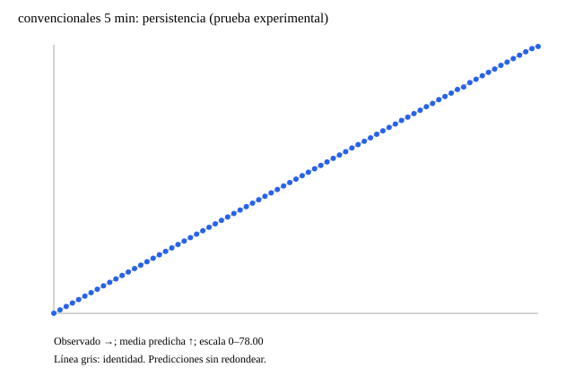
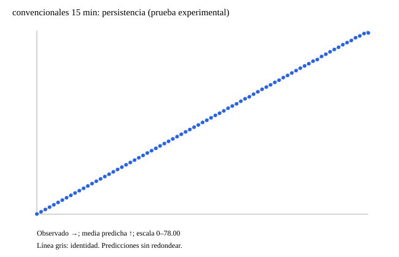
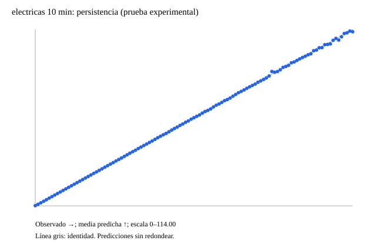
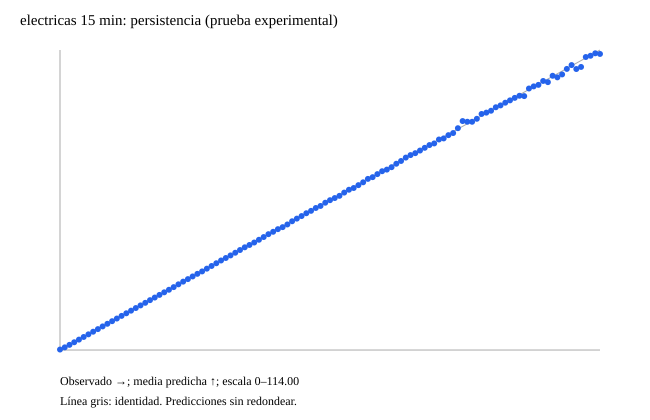

# Resultados U1 con el histórico ampliado

> La evidencia completa de esta ejecución corresponde a **local[2]** y al notebook archivado. El principal incorpora ahora [paralelismo configurable](../configuracion/spark_master.md), con pruebas pequeñas verificadas; no se volvió a ejecutar el flujo completo ni se atribuyen estos tiempos a local[4].

Ejecución completa **`20261117T171917344468Z`**, distinta de la prueba preliminar de un día. Fuente de verdad: su manifiesto y sus tablas locales; no se mezclan ejecuciones interrumpidas o antiguas.

## Datos, periodos y calidad

Se utilizaron 2.121 originales (149.089.863 bytes): 2.105 estados y ocho capturas de cada catálogo. Rango: 9/11/2026 desde 16:35 UTC, contexto parcial; siete días UTC de 288 capturas, 10–16/11. Último día terminado al inventariar: 16/11. Se descargaron 1.831 pendientes, se conservaron 290 y la segunda pasada omitió todos sin transferir.

Train: 10–13; validación: 14; prueba: 15–16, todos UTC, comunes a estaciones. El contexto del 9 no se usa como emisión entrenable. Los objetivos que cruzan cortes se purgan. Es un solo ciclo semanal: no demuestra estacionalidad ni repetibilidad semanal. Los horarios locales no coinciden con las fronteras UTC.

Conteos anchos reconciliados: `{"silver": {"entrada": 5302934, "aceptados": 5150956, "excluidos": 151978, "schema_verificado": true, "multiconjunto_reconciliado": true}, "gold": {"candidatos": 15908802, "aceptados": 14748181, "excluidos": 1160621}}`. Gold contiene dos objetivos, no dos copias por tipo. La entrada no tenía claves estación/captura repetidas, IDs vacíos ni timestamps de captura repetidos entre archivos.

Hay 170346 discrepancias total/tipos sobre 5302934 observaciones. La representación por tipo sigue siendo una convención de objetivo; su exactitud física y la causa de las diferencias siguen sin confirmarse. No se fuerza igualdad ni se excluyen todos los casos discrepantes.

[Detalle de cobertura/calidad](cobertura_y_calidad.md) y [protocolo fijado previamente](metodologia.md).

### Poblaciones por tipo/horizonte y partición

| tipo | horizonte_min | particion_temporal | count |
| --- | --- | --- | --- |
| convencionales | 5 | prueba | 1399056 |
| convencionales | 5 | train | 2824097 |
| convencionales | 5 | validacion | 700836 |
| convencionales | 10 | prueba | 1396457 |
| convencionales | 10 | train | 2821248 |
| convencionales | 10 | validacion | 698340 |
| convencionales | 15 | prueba | 1393862 |
| convencionales | 15 | train | 2818438 |
| convencionales | 15 | validacion | 695847 |
| electricas | 5 | prueba | 1399056 |
| electricas | 5 | train | 2824097 |
| electricas | 5 | validacion | 700836 |
| electricas | 10 | prueba | 1396457 |
| electricas | 10 | train | 2821248 |
| electricas | 10 | validacion | 698340 |
| electricas | 15 | prueba | 1393862 |
| electricas | 15 | train | 2818438 |
| electricas | 15 | validacion | 695847 |

## Comparación y selección

Se realizaron **30 ajustes MLlib**: tres regularizaciones LR y dos RF por cada tipo/horizonte, además de persistencia sin entrenamiento. Son 36 comparaciones de validación y 36 de prueba, con las mismas filas por combinación. Imputación/transformaciones solo se ajustaron con train. No se ajustaron cortes ni candidatos después de consultar prueba.

El log de LR sin regularización registró covarianza singular y el reintento automático de Spark con Quasi-Newton. Se conservó ese candidato preregistrado y se exigieron predicciones finitas; no se cambiaron los hiperparámetros para favorecerlo. La redundancia de variables es una explicación posible, no un diagnóstico causal probado.

La selección se congeló a `2026-11-17T18:32:41.532703+00:00`; evaluación de prueba desde `2026-11-17T18:32:41.672055+00:00`. SHA-256 congelado: `55a9849595397cbaaddacfe3329ab122ab73567fe870955c1e34278b54365077`. El criterio fue MAE de validación, no las métricas de esta tabla de prueba. No se decide un horizonte definitivo.

| tipo | horizonte_min | candidato | n | MAE | RMSE | R2 | MAE_persistencia |
| --- | --- | --- | --- | --- | --- | --- | --- |
| convencionales | 5 | persistencia | 1399056 | 0.07996535 | 0.34623192 | 0.99862410 | 0.07996535 |
| convencionales | 10 | persistencia | 1396457 | 0.14172653 | 0.48616459 | 0.99728707 | 0.14172653 |
| convencionales | 15 | persistencia | 1393862 | 0.19407588 | 0.59803741 | 0.99589468 | 0.19407588 |
| electricas | 5 | persistencia | 1399056 | 0.18320925 | 0.56764940 | 0.99691279 | 0.18320925 |
| electricas | 10 | persistencia | 1396457 | 0.30528616 | 0.80221349 | 0.99383345 | 0.30528616 |
| electricas | 15 | persistencia | 1393862 | 0.40343664 | 0.98678549 | 0.99066837 | 0.40343664 |

[Comparación completa de candidatos](comparacion_modelos.md). Se mantienen ganadores reales, sean estimadores o persistencia. Esta última no requiere fit. El mejor candidato MLlib por validación también queda identificado como referencia, sin reemplazar al ganador global.

### Estratos de los ganadores

| tipo | horizonte_min | candidato | dimension | categoria | n | MAE | RMSE | R2 |
| --- | --- | --- | --- | --- | --- | --- | --- | --- |
| convencionales | 5 | persistencia | estrato_discrepancia | con_discrepancias | 82676 | 0.39486671 | 0.88653001 | 0.99416546 |
| convencionales | 5 | persistencia | estrato_discrepancia | sin_discrepancias | 1316380 | 0.06018779 | 0.27936416 | 0.99906554 |
| convencionales | 5 | persistencia | cambio_objetivo | cambia | 96266 | 1.16215486 | 1.31992178 | 0.98694065 |
| convencionales | 5 | persistencia | cambio_objetivo | igual | 1302790 | 0.00000000 | 0.00000000 | 1.00000000 |
| convencionales | 10 | persistencia | estrato_discrepancia | con_discrepancias | 82618 | 0.57264761 | 1.12350131 | 0.99063929 |
| convencionales | 10 | persistencia | estrato_discrepancia | sin_discrepancias | 1313839 | 0.11462896 | 0.41454131 | 0.99794209 |
| convencionales | 10 | persistencia | cambio_objetivo | cambia | 158224 | 1.25085322 | 1.44431169 | 0.98409690 |
| convencionales | 10 | persistencia | cambio_objetivo | igual | 1238233 | 0.00000000 | 0.00000000 | 1.00000000 |
| convencionales | 15 | persistencia | estrato_discrepancia | con_discrepancias | 82554 | 0.71958960 | 1.32971412 | 0.98684747 |
| convencionales | 15 | persistencia | estrato_discrepancia | sin_discrepancias | 1311308 | 0.16099193 | 0.51850809 | 0.99678109 |
| convencionales | 15 | persistencia | cambio_objetivo | cambia | 204211 | 1.32468378 | 1.56242320 | 0.98107938 |
| convencionales | 15 | persistencia | cambio_objetivo | igual | 1189651 | 0.00000000 | 0.00000000 | 1.00000000 |
| electricas | 5 | persistencia | estrato_discrepancia | con_discrepancias | 82676 | 0.84268712 | 1.39818036 | 0.99239290 |
| electricas | 5 | persistencia | estrato_discrepancia | sin_discrepancias | 1316380 | 0.14179036 | 0.46870490 | 0.99761708 |
| electricas | 5 | persistencia | cambio_objetivo | cambia | 200421 | 1.27890790 | 1.49977504 | 0.98926322 |
| electricas | 5 | persistencia | cambio_objetivo | igual | 1198635 | 0.00000000 | 0.00000000 | 1.00000000 |
| electricas | 10 | persistencia | estrato_discrepancia | con_discrepancias | 82618 | 1.13406280 | 1.83877769 | 0.98682264 |
| electricas | 10 | persistencia | estrato_discrepancia | sin_discrepancias | 1313839 | 0.25317029 | 0.68658647 | 0.99488731 |
| electricas | 10 | persistencia | cambio_objetivo | cambia | 301748 | 1.41283124 | 1.72576456 | 0.98440668 |
| electricas | 10 | persistencia | cambio_objetivo | igual | 1094709 | 0.00000000 | 0.00000000 | 1.00000000 |
| electricas | 15 | persistencia | estrato_discrepancia | con_discrepancias | 82554 | 1.36974586 | 2.20704921 | 0.98109014 |
| electricas | 15 | persistencia | estrato_discrepancia | sin_discrepancias | 1311308 | 0.34260220 | 0.85345650 | 0.99209101 |
| electricas | 15 | persistencia | cambio_objetivo | cambia | 370905 | 1.51611599 | 1.91293979 | 0.97966687 |
| electricas | 15 | persistencia | cambio_objetivo | igual | 1022957 | 0.00000000 | 0.00000000 | 1.00000000 |

Todos, con/sin discrepancias y cambia/igual se calculan con las mismas predicciones. Cada dimensión de subgrupos reconcilia su N global. Igual/cambia compara los extremos observados del horizonte: no demuestra ausencia de movimientos intermedios. No se redondearon predicciones a enteros; se aplicó el clipping negativo fijado antes de evaluar.

### Por estación

| tipo | horizonte_min | candidato | estaciones | MAE_macro | p50_p95_MAE_estacion |
| --- | --- | --- | --- | --- | --- |
| convencionales | 5 | persistencia | 2459 | 0.07973816 | [0.04, 0.27304347826086955] |
| convencionales | 10 | persistencia | 2459 | 0.14133799 | [0.078397212543554, 0.46689895470383275] |
| convencionales | 15 | persistencia | 2459 | 0.19354089 | [0.11169284467713787, 0.6212914485165794] |
| electricas | 5 | persistencia | 2459 | 0.18287304 | [0.10434782608695652, 0.5895652173913043] |
| electricas | 10 | persistencia | 2459 | 0.30472688 | [0.1916376306620209, 0.921602787456446] |
| electricas | 15 | persistencia | 2459 | 0.40283736 | [0.2670157068062827, 1.1832460732984293] |

Las tablas Parquet completas conservan N y errores por estación; el promedio macro no sustituye al global ponderado. Las verificaciones recargaron los resultados y reconciliaron suma de N y MAE ponderado. Las estaciones sin observaciones futuras elegibles no forman parte de esos denominadores.

## Interpretación de Random Forest

| tipo | horizonte_min | candidato | variable_vector | importancia |
| --- | --- | --- | --- | --- |
| convencionales | 10 | rf_16_depth6 | convencionales_max15__mediana | 0.22828820 |
| convencionales | 10 | rf_16_depth6 | convencionales_actual__mediana | 0.21665322 |
| convencionales | 10 | rf_16_depth6 | convencionales_lag5__mediana | 0.16892506 |
| convencionales | 10 | rf_8_depth4 | convencionales_max15__mediana | 0.31624504 |
| convencionales | 10 | rf_8_depth4 | convencionales_actual__mediana | 0.24534220 |
| convencionales | 10 | rf_8_depth4 | convencionales_lag5__mediana | 0.20508626 |
| convencionales | 15 | rf_16_depth6 | convencionales_max15__mediana | 0.23468410 |
| convencionales | 15 | rf_16_depth6 | convencionales_actual__mediana | 0.21032964 |
| convencionales | 15 | rf_16_depth6 | convencionales_lag5__mediana | 0.16578015 |
| convencionales | 15 | rf_8_depth4 | convencionales_max15__mediana | 0.31575489 |
| convencionales | 15 | rf_8_depth4 | convencionales_actual__mediana | 0.24320562 |
| convencionales | 15 | rf_8_depth4 | convencionales_lag5__mediana | 0.20607929 |
| convencionales | 5 | rf_16_depth6 | convencionales_max15__mediana | 0.23842646 |
| convencionales | 5 | rf_16_depth6 | convencionales_actual__mediana | 0.21557490 |
| convencionales | 5 | rf_16_depth6 | convencionales_lag5__mediana | 0.17095358 |
| convencionales | 5 | rf_8_depth4 | convencionales_max15__mediana | 0.31627981 |
| convencionales | 5 | rf_8_depth4 | convencionales_actual__mediana | 0.24202884 |
| convencionales | 5 | rf_8_depth4 | convencionales_lag5__mediana | 0.19998047 |
| electricas | 10 | rf_16_depth6 | electricas_actual__mediana | 0.28849704 |
| electricas | 10 | rf_16_depth6 | electricas_lag5__mediana | 0.16688585 |
| electricas | 10 | rf_16_depth6 | electricas_media15__mediana | 0.12748536 |
| electricas | 10 | rf_8_depth4 | electricas_actual__mediana | 0.38978287 |
| electricas | 10 | rf_8_depth4 | electricas_max15__mediana | 0.12792098 |
| electricas | 10 | rf_8_depth4 | electricas_lag15__mediana | 0.12253965 |
| electricas | 15 | rf_16_depth6 | electricas_actual__mediana | 0.28716778 |
| electricas | 15 | rf_16_depth6 | electricas_lag5__mediana | 0.16682938 |
| electricas | 15 | rf_16_depth6 | electricas_media15__mediana | 0.14277534 |
| electricas | 15 | rf_8_depth4 | electricas_actual__mediana | 0.38093063 |
| electricas | 15 | rf_8_depth4 | electricas_media15__mediana | 0.18091638 |
| electricas | 15 | rf_8_depth4 | electricas_lag15__mediana | 0.12226473 |
| electricas | 5 | rf_16_depth6 | electricas_actual__mediana | 0.29080197 |
| electricas | 5 | rf_16_depth6 | electricas_lag5__mediana | 0.16177928 |
| electricas | 5 | rf_16_depth6 | electricas_media15__mediana | 0.13447851 |
| electricas | 5 | rf_8_depth4 | electricas_actual__mediana | 0.38786570 |
| electricas | 5 | rf_8_depth4 | electricas_max15__mediana | 0.12726007 |
| electricas | 5 | rf_8_depth4 | electricas_lag15__mediana | 0.12595631 |

Importancia por reducción de impureza sobre train. Los componentes están en el orden vectorial guardado; los indicadores de ausencia se distinguen de los conteos. La correlación entre actuales, rezagos y estadísticas puede repartir su importancia. No es efecto causal ni una validación física de las etiquetas.

## Artefactos, notebook y reproducibilidad

Notebook archivado de esta ejecución completo desde kernel limpio: **11 celdas de código, 0 errores**, ejecución de entrenamiento nueva `20261117T171917344468Z`. El mismo orquestador se ejecuta por CLI o notebook. No se usaron JSON de resultados preliminares para preparar estas entradas.

Versiones: `{"integracion": "u1-integrado-v2-historico", "silver": "silver-v2-tipos-gbfs", "gold": "gold-v3-emparejamiento-estrecho", "modelado": "modelado-v2-regularizacion-interpretacion", "spark": "4.2.0", "python": "3.10.22", "java": "21.0.13", "docker_imagen_id": "sha256:776b7bfde33a05e845392e5bf9cc88be81167c0b328f40142de729def297120d"}`. Duración del flujo: 5433.20 s.

Todas las recargas de ganadores y referencias MLlib:

| tipo | horizonte_min | n | nulos | max_diferencia |
| --- | --- | --- | --- | --- |
| convencionales | 5 | 1399056 | 0 | 0.00000000 |
| convencionales | 10 | 1396457 | 0 | 0.00000000 |
| convencionales | 15 | 1393862 | 0 | 0.00000000 |
| electricas | 5 | 1399056 | 0 | 0.00000000 |
| electricas | 10 | 1396457 | 0 | 0.00000000 |
| electricas | 15 | 1393862 | 0 | 0.00000000 |

| tipo | horizonte_min | candidato | n | nulos | max_diferencia |
| --- | --- | --- | --- | --- | --- |
| convencionales | 5 | lr_sin_regularizar | 1399056 | 0 | 0.00000000 |
| convencionales | 10 | lr_sin_regularizar | 1396457 | 0 | 0.00000000 |
| convencionales | 15 | lr_sin_regularizar | 1393862 | 0 | 0.00000000 |
| electricas | 5 | lr_sin_regularizar | 1399056 | 0 | 0.00000000 |
| electricas | 10 | lr_sin_regularizar | 1396457 | 0 | 0.00000000 |
| electricas | 15 | lr_sin_regularizar | 1393862 | 0 | 0.00000000 |

Se guardan todos los pipelines en `modelos/candidatos/`; contratos ganadores y de referencia apuntan a esos mismos artefactos. El contrato incluye clipping y predictores; la función `predecir` aplica la transformación completa. `modelos/interpretacion/` conserva los doce RF y `modelos/resultado.json`/CSV guardan las métricas con precisión completa.

Raíz de esta única ejecución: `data/ejecuciones/20261117T171917344468Z`. Schema/conteos/multiconjuntos, unicidad, tiempos, continuidad y purga fueron verificados. El plan de fecha se obtuvo sin caché e incluye fecha en PartitionFilters, con N comparado contra el conteo previo a escribir. Raw conserva sus hashes.

La prueba de un día se conserva como antecedente en su notebook archivado y ejecuciones originales. Sus métricas provienen de otra población y no cuantifican una mejora atribuible a ampliar el histórico. Dos ejecuciones ampliadas interrumpidas se conservan fallidas, sin reutilizar sus salidas.

Lectura del contraste por cambios: LR sin regularización tiene un MAE ligeramente menor que persistencia dentro del subconjunto donde cambia el conteo, en las seis combinaciones de prueba, pero pierde globalmente. Los conteos iguales pesan mucho y persistencia tiene error cero en ese subconjunto por definición. Este diagnóstico no cambia la selección ni autoriza afirmar utilidad operativa.

## Qué permite concluir

Permite comparar estos candidatos en los dos días posteriores reservados y describir sus errores por tipo, horizonte, discrepancias y cambio de conteo. No acredita una exactitud física ni un umbral operativo aceptable de redistribución. No demuestra generalización estacional ni un patrón semanal repetido; hay pocos días independientes y train contiene sobre todo días laborables. Los millones de pares estación/instante y sus horizontes solapados no equivalen a millones de periodos independientes. Un R² global elevado tampoco demuestra mejora frente a persistencia ni buen rendimiento cuando cambia el conteo. Se necesitan nuevas fechas prospectivas y más ciclos para evaluar estabilidad.

[Propuesta del brief y decisión Lambda/Kappa](propuesta_brief_disponibilidad.md). [Evidencias personales pendientes](evidencias_personales.md). U2 no está implementada. Sin cambios en compañeros, Dockerfile/Compose, commits o push.

## Reutilización comprobada

La ejecución `20261117T191621979673Z` reutilizó esta fuente compatible en 84.67 s, sin entrenar ni descargar. Verificó hashes y reprodujo las predicciones de los seis ganadores. [Registro público sin secretos](verificacion_reutilizacion.json). El notebook principal conserva la ejecución nueva completa, no se sustituyó por esta reutilización.

