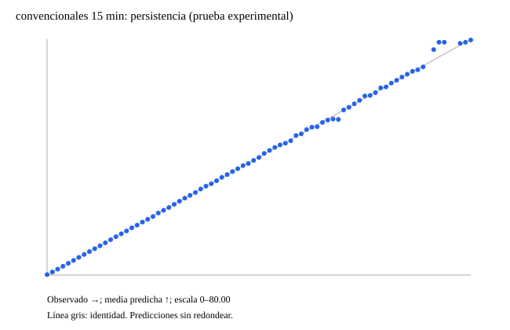
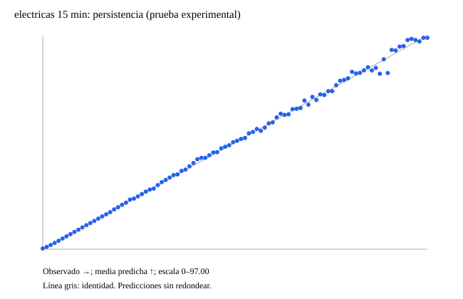

# Verificación ejecutada — fase 6

> Antecedente de la prueba preliminar de un día. Los resultados ampliados se documentan en [reports/ampliacion](../ampliacion/metodologia.md); no sustituir sus cifras con las de este informe.
> El notebook principal se actualizó; la versión preliminar está [archivada](../../notebooks/archivo/00_prueba_preliminar_un_dia.ipynb).

Ejecución integrada nueva `20261117T142303450900Z`; reutilización `20261117T144109506933Z`. Ambas finalizaron con código 0 y estado `completada`.

Entorno verificado: Spark 4.2.0, Python 3.10.22, Java 21.0.13. Dockerfile y Compose sin cambios; montaje del proyecto en `/opt` verificado por el lanzador.

## Periodo y linaje

Solo los 290 originales locales: 288 station_status, una station_information y una vehicle_types. Estados del 10/11/2026 UTC, de 00:00:02.493 a 23:55:01.713; 2.520 estaciones. No hubo nuevas descargas. Los SHA-256 de los 290 archivos coinciden también con las entradas conservadas de fase 4.

Los JSON no tienen captured_at: captura_utc viene del nombre. last_updated/last_reported internos se conservan. La frecuencia y sus huecos fueron investigados en fase 2; no se declara una frecuencia de dos minutos.

Una sola ejecución nueva alimenta todas las etapas:

```text
pyspark/jupyter/UNIDAD1/Dim-Disponibilidad/data/ejecuciones/20261117T142303450900Z/silver
pyspark/jupyter/UNIDAD1/Dim-Disponibilidad/data/ejecuciones/20261117T142303450900Z/gold
pyspark/jupyter/UNIDAD1/Dim-Disponibilidad/data/ejecuciones/20261117T142303450900Z/modelos
```

Estas son rutas del host relativas a la raíz del repositorio. En Docker, el prefijo `pyspark/jupyter` corresponde a `/opt`. No se utilizaron ni mezclaron las carpetas históricas `data/silver`, `data/gold` o `data/modelos` de fases anteriores.

| Etapa | Entrada/candidatos | Aceptados | Excluidos conservados |
|---|---:|---:|---:|
| Silver | 725.706 | 707.762 | 17.944 |
| Gold (formato ancho, dos objetivos) | 2.177.118 | 2.078.519 | 98.599 |

Los motivos de exclusión se pueden solapar; los registros se reconcilian mediante conjuntos disjuntos, sin sumar motivos. Se verificaron esquema, multiconjuntos en ambos sentidos, claves únicas, tiempos pasados de predictores, calidad futura, tolerancia y purga de los límites temporales.

## Cortes y conteos

Train: inicio del día a 16:00 UTC; validación: 16:00–20:00 UTC; prueba: 20:00–00:00 UTC siguiente. Objetivos estrictamente antes del final de su partición. No se retocaron cortes.

| Horizonte | Train | Validación | Prueba |
|---:|---:|---:|---:|
| 5 min | 469,669 | 115,267 | 115,361 |
| 10 min | 467,147 | 112,792 | 112,896 |
| 15 min | 464,635 | 110,321 | 110,431 |

Estos conteos son iguales para cada tipo en este histórico. Las filas Gold no se duplican por tipo. Coinciden con los conteos de fase 4. Se mantienen las 30 variables y las reglas de fase 3.

## Comparación nueva por MAE de validación

24 ajustes MLlib (12 LR y 12 RF), más seis líneas base sin entrenamiento. Todas las configuraciones usan las mismas filas de evaluación por tipo/horizonte. Esta tabla pertenece a la ejecución integrada, no a la ejecución histórica de fase 5.

| Tipo | Min | Persistencia | Ridge .01 | Ridge .1 | RF 8/d4 | RF 16/d6 |
|---|---:|---:|---:|---:|---:|---:|
| convencionales | 5 | 0.119063 | 0.141019 | 0.143741 | 1.766547 | 0.737727 |
| convencionales | 10 | 0.207373 | 0.242111 | 0.241179 | 1.662291 | 0.790476 |
| convencionales | 15 | 0.280454 | 0.324324 | 0.321190 | 1.777881 | 0.850538 |
| electricas | 5 | 0.243157 | 0.278596 | 0.279572 | 1.507663 | 0.929517 |
| electricas | 10 | 0.392448 | 0.449536 | 0.444443 | 1.550687 | 1.075464 |
| electricas | 15 | 0.505371 | 0.580580 | 0.571081 | 1.542793 | 1.155022 |

**Persistencia ganó las seis combinaciones** por MAE de validación. No necesita entrenamiento y se guarda como contrato, no como PipelineModel aprendido. Los candidatos MLlib se entrenaron y evaluaron; sus métricas quedan registradas aunque no ganaran. No se elige un horizonte definitivo.

La selección se congeló a 2026-11-17T14:36:43.482551+00:00; la evaluación de prueba comenzó a 2026-11-17T14:36:43.626708+00:00. SHA-256 de selección inalterado: `8bdeac3a2dad0272f829e299acfb03e3c8ee67cce2d39f9ef1a206f7efb81abb`.

## Prueba experimental de los ganadores fijados

| Tipo | Min | N | MAE | RMSE | R² |
|---|---:|---:|---:|---:|---:|
| convencionales | 5 | 115,361 | 0.177998 | 0.505189 | 0.996868 |
| convencionales | 10 | 112,896 | 0.304404 | 0.727507 | 0.993497 |
| convencionales | 15 | 110,431 | 0.407467 | 0.903945 | 0.989949 |
| electricas | 5 | 115,361 | 0.396850 | 0.885770 | 0.990680 |
| electricas | 10 | 112,896 | 0.635860 | 1.294448 | 0.979955 |
| electricas | 15 | 110,431 | 0.826181 | 1.629333 | 0.968011 |

Las tablas CSV locales en `modelos/` conservan la precisión completa de métricas globales (30 validación y 30 prueba) y 120 filas de subgrupos. No se redondean predicciones a enteros. Las seis tablas Parquet por estación y las seis de predicciones elegidas fueron leídas de vuelta.

### Condicionado a discrepancias y cambios, ganador

| Tipo | Min | Sin discrepancias n / MAE | Con discrepancias n / MAE | Cambia n / MAE | Igual n / MAE |
|---|---:|---:|---:|---:|---:|
| convencionales | 5 | 100,502 / 0.127132 | 14,859 / 0.522041 | 17,140 / 1.198016 | 98,221 / 0.000000 |
| convencionales | 10 | 98,376 / 0.235047 | 14,520 / 0.774311 | 25,863 / 1.328771 | 87,033 / 0.000000 |
| convencionales | 15 | 96,137 / 0.322779 | 14,294 / 0.977053 | 31,302 / 1.437512 | 79,129 / 0.000000 |
| electricas | 5 | 100,502 / 0.292462 | 14,859 / 1.102901 | 32,554 / 1.406310 | 82,807 / 0.000000 |
| electricas | 10 | 98,376 / 0.500346 | 14,520 / 1.553994 | 43,788 / 1.639399 | 69,108 / 0.000000 |
| electricas | 15 | 96,137 / 0.662014 | 14,294 / 1.930320 | 50,022 / 1.823917 | 60,409 / 0.000000 |

Sin+con reconcilian con el N global; no hay estratos desconocidos elegibles en este día. Cambia+igual también reconcilian. Persistencia tiene error cero cuando no hay cambios por definición; su MAE global no demuestra anticipación de movimientos. Los indicadores futuros se usaron solo para evaluación.

## Recarga y reutilización

Se recargaron los seis contratos y se reprodujeron **677.376 predicciones** de prueba. En cada combinación: claves únicas, sin nulos, mismo N, diferencia máxima **0.0**. La suma de n por estación y el MAE ponderado coinciden con las métricas globales (tolerancia 1e-10). El test sintético también verifica guardado/recarga de un pipeline LR con sus transformaciones; no se presenta ese test como un modelo MLlib seleccionado en el histórico.

La nueva ejecución duró 977.52 s y registró 223 archivos de artefactos con SHA-256 (91,062,175 bytes). La reutilización duró 45.56 s y solo ejecutó inventario, verificación de reutilización y comprobación de raw/código; no ajustó modelos ni regeneró Silver/Gold.

Los manifiestos completos permanecen en `data/ejecuciones/<id>/manifiesto.json`, fuera de Git, junto a configuración, logs y salidas. La huella de compatibilidad es `0907a52238034b3caa43842c7ba1b7f76a9b14d84ad4bd6b95e14bd2bad1d2e3`.

Los ajustes RF de esta ejecución tienen sus propias métricas y no se confunden con los de fase 5. La recarga es reproducible; no se afirma identidad binaria de nuevos entrenamientos distribuidos bajo otro particionado físico.

## Pruebas y comprobaciones pendientes

La suite completa pasó en Docker: **31 pruebas, 0 fallos, 0 omitidas**, 92.152 s. Incluye lectura, calidad, huecos/objetivos/cortes, imputación solo train, recarga LR, selección/empates y controles de configuración/manifiesto/reutilización. Las pruebas del descargador usan dobles locales, sin contactar Supabase. La ausencia de BLAS/LAPACK nativas opcionales genera avisos; Spark usa su alternativa y completó ajustes y pruebas. No se instalaron dependencias.

La nueva sección independiente del notebook se ejecutó en el mismo Docker:
**3 celdas de código ejecutadas, 0 errores**. Mostró manifiesto, linaje, versiones,
conteos y métricas; comprobó inventario/código/artefactos y volvió a reproducir
las seis selecciones guardadas. El notebook conserva las salidas históricas de
fases 2–5, que no se afirman reejecutadas en fase 6. El flujo completo se ejecutó
mediante el punto de entrada; el notebook verifica y presenta esa ejecución.

No se probó la opción de descarga contra Supabase en esta fase por instrucción explícita; se reutiliza el descargador previamente implementado. No se acredita capturador, U2 ni inferencia desplegada. Al cerrar fase 6 no estaba disponible la guía oficial; la [revisión final posterior](../cumplimiento_u1/revision_final.md) ya la consulta y sustituye la matriz provisional de [entrega_u1.md](entrega_u1.md).

**Limitaciones:** conteos reportados por tipo sin exactitud física confirmada; un solo día UTC ya inspeccionado; prueba experimental sin independencia final; sin evidencia de generalización semanal o estacional. No hubo commits ni push ni cambios en dimensiones de compañeros.




