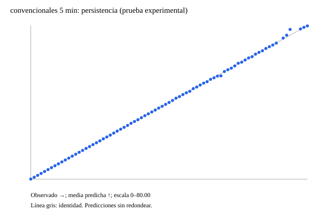
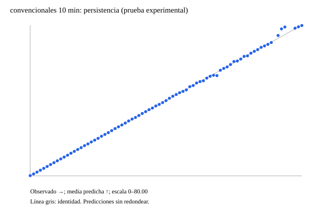
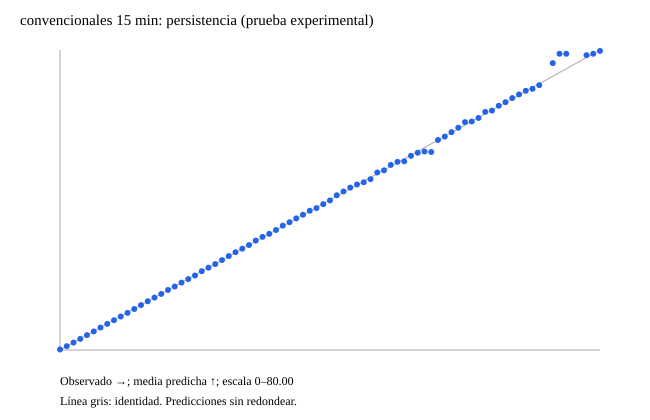
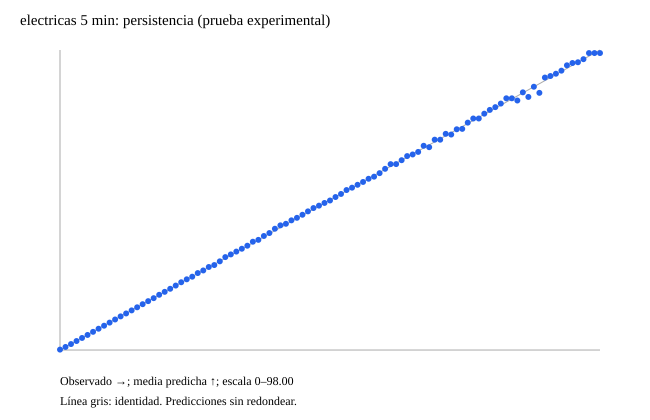

# Fase 5 — comparación y evaluación experimental

> Antecedente de la prueba preliminar de un día. Los resultados ampliados se documentan en [reports/ampliacion](../ampliacion/metodologia.md); no sustituir sus cifras con las de este informe.
> El notebook principal se actualizó; la versión preliminar está [archivada](../../notebooks/archivo/00_prueba_preliminar_un_dia.ipynb).

Ejecución `20261117T052627988920Z`, versión `modelado-v1-validacion-mae`, en Docker Spark 4.2.0 / Python 3.10.22. Duración del experimento: **270.202 s** (comparación, selección, evaluación y artefactos). [Código reutilizable](../../src/modelado.py), [protocolo previo](protocolo.md) y [notebook ejecutado](../../notebooks/01_disponibilidad_batch.ipynb).

## Entradas y límites

Gold único: `gold-v1-conteos-reportados`, ejecución `20261117T044523230826Z`. Se usaron solo sus aceptados y las elegibilidades por tipo existentes. No se descargaron datos, no se alteraron raw/Silver/Gold ni se cambiaron cortes. Todo procede del 2026-11-10 UTC, un día ya inspeccionado, con dos fechas locales parciales. Los resultados no constituyen prueba final independiente ni confirman exactitud física: son errores frente a **conteos reportados por tipo**. Elegibilidad no garantiza exactitud física.

Los cortes originales se mantuvieron: train antes de 16:00 UTC, validación [16:00,20:00), prueba [20:00,24:00), con objetivos purgados antes del siguiente corte. No se escogió horizonte usando prueba; se conservan 5, 10 y 15 minutos.

### Conteos por tipo y horizonte

Las cifras coinciden para convencionales y eléctricas en este día, pero cada tipo se filtra y evalúa por su elegibilidad propia. Son los mismos casos para todos los candidatos dentro de la combinación.

| Horizonte | Train por tipo | Validación por tipo | Prueba por tipo |
|---|---:|---:|---:|
| 5 min | 469.669 | 115.267 | 115.361 |
| 10 min | 467.147 | 112.792 | 112.896 |
| 15 min | 464.635 | 110.321 | 110.431 |

Se hicieron **30 comparaciones de validación** y **30 evaluaciones descriptivas de prueba**: cinco candidatos × dos tipos × tres horizontes. Hubo 24 ajustes MLlib (12 LR y 12 RF); persistencia no tiene entrenamiento. No se aprendieron parámetros con validación o prueba.

## Predictores y tratamiento de nulos

Lista explícita: los 30 numéricos deterministas de Gold (actual, rezagos/cambios 5/10/15, media/min/max/std/n de historia de 15 minutos para ambos tipos, hora, minuto, día ISO, fin de semana, seno/coseno de hora). station_id solo se usó para auditoría y resumen por estación: se evitó una codificación de miles de estaciones en este ensayo de un día. No se hace búsqueda automática de columnas.

Objetivos, tiempos futuros, horizonte efectivo, estratos, motivos, flags futuros y de reporte retrospectivo no forman parte del vector. Su presencia en el DataFrame de evaluación no los convierte en predictores; solo el orden explícito entra al assembler.

Para cada combinación se ajustó mediana con train (relativeError=0.001) más un indicador de ausencia por predictor. Se conservaron los 30: ninguno estaba completamente nulo en train. El vector tiene 60 entradas (30 imputadas + 30 indicadores) en orden registrado. No se eliminaron filas por nulos ni se sustituyeron automáticamente ausencias por cero. Una mediana aprendida igual a cero es un valor de train, distinto de imponer cero. La estandarización interna de LR se estimó solo en fit sobre train; RF no se escaló.

| Horizonte | Nulos lag5 train | Nulos lag10 train | Nulos lag15 train | Nulos media15 train | Nulos lag15 validación |
|---|---:|---:|---:|---:|---:|
| 5 | 2.522 | 5.034 | 7.546 | 2.522 | 61 |
| 10 | 2.512 | 5.024 | 7.534 | 2.512 | 54 |
| 15 | 2.512 | 5.022 | 7.527 | 2.512 | 49 |

Los conteos de nulos son iguales para las variables equivalentes de ambos tipos en este histórico; también coinciden entre las dos combinaciones de objetivo para un mismo horizonte. Se registraron todos los predictores, medianas, schemas y perfiles completos en la selección congelada. Los casos de historia ausente no se eliminaron de evaluación.

## Candidatos, política y congelación

Persistencia usa el valor reportado actual. LR compara ridge 0.01 y 0.1, maxIter=40, tol=1e-6, elasticNetParam=0 y estandarización interna. RF compara 8 árboles/profundidad 4 y 16/profundidad 6, maxBins=32, minInstancesPerNode=20, sqrt de variables, 128 MB para histogramas y seed=42. Se mantuvo local[2]/driver 3 GB, sin modificar Dockerfile o Compose. La búsqueda acotada no establece la capacidad máxima de estas familias.

La política previa aplicó `max(0,prediccion_raw)` a todos los candidatos, sin límite superior ni redondeo entero. Se contaron predicciones negativas originales. Selección por MAE de validación; empates absolutos dentro de 1e-6 favorecen persistencia, LR 0.01, LR 0.1, RF pequeño y RF mayor. No se usa RMSE/R² ni prueba para desempatar. Las métricas de tablas se muestran con seis decimales; CSV/JSON y predicciones guardan precisión numérica completa.

La selección y los contratos se guardaron en **2026-11-17T05:30:41.143976+00:00**. La lectura/evaluación de prueba comenzó después, en **2026-11-17T05:30:41.334334+00:00**. Se comprobó que el archivo congelado mantuvo SHA-256 `100c4eaa4c24e4560a9f2d76913ee909c31a0d82edd570e839eafa6cbba0834b` durante toda prueba. No hubo refit ni reselección.

### Comparativa completa de validación

| Tipo | Horizonte | Candidato | MAE | RMSE | R² | Fit (s) |
|---|---:|---|---:|---:|---:|---:|
| convencionales | 5 | persistencia | 0.119063 | 0.390177 | 0.998243 | 0.000 |
| convencionales | 5 | lr_ridge_001 | 0.141019 | 0.393349 | 0.998214 | 2.524 |
| convencionales | 5 | lr_ridge_01 | 0.143741 | 0.399563 | 0.998158 | 2.084 |
| convencionales | 5 | rf_8_depth4 | 1.449714 | 2.420395 | 0.932390 | 6.417 |
| convencionales | 5 | rf_16_depth6 | 0.731658 | 1.994186 | 0.954105 | 8.641 |
| convencionales | 10 | persistencia | 0.207373 | 0.548696 | 0.996526 | 0.000 |
| convencionales | 10 | lr_ridge_001 | 0.242111 | 0.554952 | 0.996446 | 1.982 |
| convencionales | 10 | lr_ridge_01 | 0.241179 | 0.558753 | 0.996397 | 1.937 |
| convencionales | 10 | rf_8_depth4 | 1.680221 | 2.605902 | 0.921641 | 6.121 |
| convencionales | 10 | rf_16_depth6 | 0.778667 | 2.000076 | 0.953840 | 8.412 |
| convencionales | 15 | persistencia | 0.280454 | 0.669641 | 0.994826 | 0.000 |
| convencionales | 15 | lr_ridge_001 | 0.324324 | 0.679070 | 0.994679 | 1.937 |
| convencionales | 15 | lr_ridge_01 | 0.321190 | 0.681115 | 0.994647 | 1.723 |
| convencionales | 15 | rf_8_depth4 | 1.575992 | 2.520251 | 0.926707 | 5.595 |
| convencionales | 15 | rf_16_depth6 | 0.828191 | 2.052853 | 0.951371 | 8.293 |
| electricas | 5 | persistencia | 0.243157 | 0.637070 | 0.996510 | 0.000 |
| electricas | 5 | lr_ridge_001 | 0.278596 | 0.650043 | 0.996366 | 1.919 |
| electricas | 5 | lr_ridge_01 | 0.279572 | 0.677689 | 0.996050 | 1.808 |
| electricas | 5 | rf_8_depth4 | 1.440448 | 3.653263 | 0.885219 | 5.574 |
| electricas | 5 | rf_16_depth6 | 0.927053 | 2.816193 | 0.931792 | 8.126 |
| electricas | 10 | persistencia | 0.392448 | 0.885328 | 0.993253 | 0.000 |
| electricas | 10 | lr_ridge_001 | 0.449536 | 0.913131 | 0.992822 | 1.854 |
| electricas | 10 | lr_ridge_01 | 0.444443 | 0.925580 | 0.992625 | 1.990 |
| electricas | 10 | rf_8_depth4 | 1.491699 | 3.634464 | 0.886291 | 5.621 |
| electricas | 10 | rf_16_depth6 | 1.084082 | 2.905261 | 0.927342 | 8.220 |
| electricas | 15 | persistencia | 0.505371 | 1.061548 | 0.990292 | 0.000 |
| electricas | 15 | lr_ridge_001 | 0.580580 | 1.107143 | 0.989440 | 1.735 |
| electricas | 15 | lr_ridge_01 | 0.571081 | 1.111798 | 0.989351 | 2.205 |
| electricas | 15 | rf_8_depth4 | 1.556392 | 3.742893 | 0.879307 | 5.525 |
| electricas | 15 | rf_16_depth6 | 1.087888 | 2.942791 | 0.925392 | 8.291 |

**Persistencia ganó por MAE en las seis combinaciones, sin necesitar el desempate.** Se conservó como ganadora. Las configuraciones LR y RF ensayadas no mejoraron ese criterio en validación. No se concluye que cualquier modelo de esas familias o un histórico mayor vaya a comportarse igual.

## Prueba después de congelar

### Ganadores fijados por validación

| Tipo | Horizonte | N | MAE | RMSE | R² |
|---|---:|---:|---:|---:|---:|
| convencionales | 5 | 115.361 | 0.177998 | 0.505189 | 0.996868 |
| convencionales | 10 | 112.896 | 0.304404 | 0.727507 | 0.993497 |
| convencionales | 15 | 110.431 | 0.407467 | 0.903945 | 0.989949 |
| electricas | 5 | 115.361 | 0.396850 | 0.885770 | 0.990680 |
| electricas | 10 | 112.896 | 0.635860 | 1.294448 | 0.979955 |
| electricas | 15 | 110.431 | 0.826181 | 1.629333 | 0.968011 |

### Comparativa completa de prueba (descriptiva, sin cambiar selección)

| Tipo | Horizonte | Candidato | MAE | RMSE | R² | Negativas raw |
|---|---:|---|---:|---:|---:|---:|
| convencionales | 5 | persistencia | 0.177998 | 0.505189 | 0.996868 | 0 |
| convencionales | 5 | lr_ridge_001 | 0.211347 | 0.504550 | 0.996876 | 2.836 |
| convencionales | 5 | lr_ridge_01 | 0.208220 | 0.505509 | 0.996864 | 3.417 |
| convencionales | 5 | rf_8_depth4 | 1.480418 | 2.383605 | 0.930269 | 0 |
| convencionales | 5 | rf_16_depth6 | 0.780707 | 1.956576 | 0.953016 | 0 |
| convencionales | 10 | persistencia | 0.304404 | 0.727507 | 0.993497 | 0 |
| convencionales | 10 | lr_ridge_001 | 0.354420 | 0.724823 | 0.993545 | 2.786 |
| convencionales | 10 | lr_ridge_01 | 0.343690 | 0.724231 | 0.993556 | 3.602 |
| convencionales | 10 | rf_8_depth4 | 1.733001 | 2.599700 | 0.916965 | 0 |
| convencionales | 10 | rf_16_depth6 | 0.841180 | 2.021760 | 0.949780 | 0 |
| convencionales | 15 | persistencia | 0.407467 | 0.903945 | 0.989949 | 0 |
| convencionales | 15 | lr_ridge_001 | 0.467757 | 0.897672 | 0.990089 | 2.806 |
| convencionales | 15 | lr_ridge_01 | 0.452535 | 0.896107 | 0.990123 | 3.774 |
| convencionales | 15 | rf_8_depth4 | 1.648243 | 2.543488 | 0.920427 | 0 |
| convencionales | 15 | rf_16_depth6 | 0.922542 | 2.089050 | 0.946321 | 0 |
| electricas | 5 | persistencia | 0.396850 | 0.885770 | 0.990680 | 0 |
| electricas | 5 | lr_ridge_001 | 0.447941 | 0.882840 | 0.990741 | 5.232 |
| electricas | 5 | lr_ridge_01 | 0.437057 | 0.883031 | 0.990737 | 6.429 |
| electricas | 5 | rf_8_depth4 | 1.318655 | 3.072915 | 0.887825 | 0 |
| electricas | 5 | rf_16_depth6 | 0.933115 | 2.502577 | 0.925600 | 0 |
| electricas | 10 | persistencia | 0.635860 | 1.294448 | 0.979955 | 0 |
| electricas | 10 | lr_ridge_001 | 0.708043 | 1.282891 | 0.980312 | 5.351 |
| electricas | 10 | lr_ridge_01 | 0.687358 | 1.279621 | 0.980412 | 6.405 |
| electricas | 10 | rf_8_depth4 | 1.432662 | 3.120857 | 0.883487 | 0 |
| electricas | 10 | rf_16_depth6 | 1.141745 | 2.704692 | 0.912489 | 0 |
| electricas | 15 | persistencia | 0.826181 | 1.629333 | 0.968011 | 0 |
| electricas | 15 | lr_ridge_001 | 0.914253 | 1.605563 | 0.968938 | 5.188 |
| electricas | 15 | lr_ridge_01 | 0.884618 | 1.598263 | 0.969220 | 6.206 |
| electricas | 15 | rf_8_depth4 | 1.551959 | 3.294771 | 0.869194 | 0 |
| electricas | 15 | rf_16_depth6 | 1.231513 | 2.827672 | 0.903654 | 0 |

Todos los candidatos tuvieron el mismo N por combinación, cero predicciones inválidas y ninguna fila descartada silenciosamente. Las negativas raw corresponden a emisiones de los modelos, no a imputaciones: el total entre candidatos se solapa sobre casos y no es un número de observaciones únicas. Persistencia y RF no produjeron negativas.

### Estratos de discrepancia de los ganadores

Se comparan las mismas predicciones sobre todos (tabla global), sin discrepancias y con discrepancias iniciales o futuras. No hubo casos desconocidos elegibles en este día. Los conteos sin+con reconcilian exactamente el N global. Las tablas extensas incluyen también los modelos no elegidos.

| Tipo | Horizonte | Estrato | N | MAE | RMSE | R² |
|---|---:|---|---:|---:|---:|---:|
| convencionales | 5 | sin_discrepancias | 100.502 | 0.127132 | 0.407036 | 0.997722 |
| convencionales | 5 | con_discrepancias | 14.859 | 0.522041 | 0.927807 | 0.993336 |
| convencionales | 10 | sin_discrepancias | 98.376 | 0.235047 | 0.608559 | 0.994887 |
| convencionales | 10 | con_discrepancias | 14.520 | 0.774311 | 1.267277 | 0.987681 |
| convencionales | 15 | sin_discrepancias | 96.137 | 0.322779 | 0.759687 | 0.992003 |
| convencionales | 15 | con_discrepancias | 14.294 | 0.977053 | 1.559240 | 0.981409 |
| electricas | 5 | sin_discrepancias | 100.502 | 0.292462 | 0.692935 | 0.992051 |
| electricas | 5 | con_discrepancias | 14.859 | 1.102901 | 1.686317 | 0.986083 |
| electricas | 10 | sin_discrepancias | 98.376 | 0.500346 | 1.035104 | 0.982118 |
| electricas | 10 | con_discrepancias | 14.520 | 1.553994 | 2.401847 | 0.971662 |
| electricas | 15 | sin_discrepancias | 96.137 | 0.662014 | 1.311584 | 0.970966 |
| electricas | 15 | con_discrepancias | 14.294 | 1.930320 | 2.989932 | 0.955737 |

El error observado es mayor en los pares con discrepancias; esto es una asociación descriptiva, no una causa demostrada ni evidencia de cuál campo es físicamente correcto. Esos pares se conservaron y no se usaron los indicadores futuros para predecir.

### Cuando el objetivo cambia y cuando permanece igual

| Tipo | Horizonte | Caso | N | % casos | MAE | RMSE | R² |
|---|---:|---|---:|---:|---:|---:|---:|
| convencionales | 5 | cambia | 17.140 | 14.86 | 1.198016 | 1.310624 | 0.985999 |
| convencionales | 5 | igual | 98.221 | 85.14 | 0.000000 | 0.000000 | 1.000000 |
| convencionales | 10 | cambia | 25.863 | 22.91 | 1.328771 | 1.519976 | 0.980622 |
| convencionales | 10 | igual | 87.033 | 77.09 | 0.000000 | 0.000000 | 1.000000 |
| convencionales | 15 | cambia | 31.302 | 28.35 | 1.437512 | 1.697858 | 0.975449 |
| convencionales | 15 | igual | 79.129 | 71.65 | 0.000000 | 0.000000 | 1.000000 |
| electricas | 5 | cambia | 32.554 | 28.22 | 1.406310 | 1.667433 | 0.982264 |
| electricas | 5 | igual | 82.807 | 71.78 | 0.000000 | 0.000000 | 1.000000 |
| electricas | 10 | cambia | 43.788 | 38.79 | 1.639399 | 2.078482 | 0.968582 |
| electricas | 10 | igual | 69.108 | 61.21 | 0.000000 | 0.000000 | 1.000000 |
| electricas | 15 | cambia | 50.022 | 45.30 | 1.823917 | 2.420889 | 0.954459 |
| electricas | 15 | igual | 60.409 | 54.70 | 0.000000 | 0.000000 | 1.000000 |

Persistencia tiene error cero cuando el objetivo no cambia **por definición**. Eso contribuye al MAE global bajo: no significa que anticipe movimientos. Para eléctricas a 15 minutos, 50.022 casos cambian y el MAE condicional es 1,823917, frente a 0,826181 global. Los R² altos también reflejan la variación de niveles entre observaciones/estaciones; no acreditan anticipación de cambios ni exactitud física.

## Resumen por estación

Se guardaron tablas Parquet completas para ganador y persistencia; como coinciden, no se duplicaron. Cada combinación incluye 2.457 estaciones con casos elegibles de prueba, no las 2.520 del raw. Cada fila contiene n, MAE, RMSE, R² y conteo de negativas. R² es nulo cuando el objetivo de una estación no varía. El promedio macro por estación se distingue del global micro ponderado por casos. Los diez mayores errores, mostrando n y exigiendo al menos diez casos, figuran en resultado.json.

| Tipo | Horizonte | Estaciones | MAE macro | Mediana MAE estación | P95 MAE estación |
|---|---:|---:|---:|---:|---:|
| convencionales | 5 | 2.457 | 0.178436 | 0.085106 | 0.659574 |
| convencionales | 10 | 2.457 | 0.305026 | 0.173913 | 1.043478 |
| convencionales | 15 | 2.457 | 0.408281 | 0.222222 | 1.355556 |
| electricas | 5 | 2.457 | 0.397956 | 0.234043 | 1.340426 |
| electricas | 10 | 2.457 | 0.637506 | 0.391304 | 2.000000 |
| electricas | 15 | 2.457 | 0.828135 | 0.533333 | 2.533333 |

### Estaciones con mayor MAE de prueba (tres por combinación)

Ranking descriptivo posterior a la selección, con n≥10; no se utiliza para elegir modelos.

| Tipo | Horizonte | station_id | N | MAE | RMSE |
|---|---:|---|---:|---:|---:|
| convencionales | 5 | 66dc3f08-0aca-11e7-82f6-3863bb44ef7c | 47 | 1.468085 | 1.816004 |
| convencionales | 5 | 5f7ac86c-1a98-4603-8749-4bb83ac84acd | 47 | 1.297872 | 1.732051 |
| convencionales | 5 | 66db8d89-0aca-11e7-82f6-3863bb44ef7c | 47 | 1.234043 | 1.946082 |
| convencionales | 10 | 5f7ac86c-1a98-4603-8749-4bb83ac84acd | 46 | 2.021739 | 2.649856 |
| convencionales | 10 | 66dd42eb-0aca-11e7-82f6-3863bb44ef7c | 46 | 2.021739 | 3.226925 |
| convencionales | 10 | 66dc1beb-0aca-11e7-82f6-3863bb44ef7c | 46 | 1.956522 | 3.850466 |
| convencionales | 15 | 66dc1beb-0aca-11e7-82f6-3863bb44ef7c | 45 | 2.933333 | 5.094660 |
| convencionales | 15 | 66dd42eb-0aca-11e7-82f6-3863bb44ef7c | 45 | 2.888889 | 4.173994 |
| convencionales | 15 | 66db8d89-0aca-11e7-82f6-3863bb44ef7c | 45 | 2.688889 | 3.991658 |
| electricas | 5 | 66dc7659-0aca-11e7-82f6-3863bb44ef7c | 47 | 2.638298 | 3.848183 |
| electricas | 5 | 1869743938848725856 | 47 | 2.553191 | 3.287630 |
| electricas | 5 | 66dd42eb-0aca-11e7-82f6-3863bb44ef7c | 47 | 2.510638 | 3.339002 |
| electricas | 10 | 66dc7659-0aca-11e7-82f6-3863bb44ef7c | 46 | 4.260870 | 6.003622 |
| electricas | 10 | c638ec67-9ac0-416f-944f-619926144931 | 46 | 4.239130 | 5.499012 |
| electricas | 10 | 66dd42eb-0aca-11e7-82f6-3863bb44ef7c | 46 | 4.130435 | 5.819756 |
| electricas | 15 | 66dc7659-0aca-11e7-82f6-3863bb44ef7c | 45 | 6.311111 | 8.008329 |
| electricas | 15 | c638ec67-9ac0-416f-944f-619926144931 | 45 | 6.222222 | 7.851398 |
| electricas | 15 | 66dd42eb-0aca-11e7-82f6-3863bb44ef7c | 45 | 5.511111 | 7.734483 |

## Gráficos de observado frente a predicho

Cada punto es la **media predicha para un valor observado**, con su n en el SVG; no son observaciones individuales ni bandas de incertidumbre. La línea gris es identidad. No se recopila el histórico completo: como máximo 200 agregados. Los gráficos complementan las métricas condicionadas a cambio, que hacen visible el error que un promedio puede ocultar.

Los archivos `<tipo>_<h>min_ejemplo_estacion.json` contienen series observado/predicho de una estación ilustrativa, elegida solo por cobertura de train y desempate por ID, no por su error en prueba.

## Artefactos y recarga

Directorio verificado en Docker: `/opt/UNIDAD1/Dim-Disponibilidad/data/modelos/20261117T052627988920Z`. Corresponde a `data/modelos/20261117T052627988920Z/` de la dimensión en el host, compartida por el volumen existente.

- seleccionados/<tipo>_<h>min/contrato.json: seis contratos de persistencia, con versión, campo requerido, restricciones, política y métricas de validación. No se presentan como pipelines entrenados: persistencia no tiene parámetros aprendidos ni requiere imputación.
- seleccion_congelada.json y politica_previa.json: candidatos, empates, clipping y selección anterior a prueba. La congelación conserva también perfiles, medianas y orden del preprocesamiento utilizado para comparar LR/RF.
- proveniencia_gold.json: UUID y versión de Gold, cortes originales, archivos Parquet con SHA-256, versiones y hash del módulo de modelado.
- comparacion_validacion.csv, comparacion_prueba.csv y subgrupos_prueba.csv: tablas completas con precisión numérica, incluidos los candidatos no elegidos.
- estaciones/<combinación>/persistencia/: métricas completas por estación en Parquet.
- predicciones/<combinación>/: predicciones seleccionadas de prueba, raw y acotadas, observado, actual, tiempos, estratos e indicadores iniciales/futuros de discrepancia.
- resultado.json: configuración, métricas, tiempos y verificación de recarga. Los datos y modelos viven fuera de Git; el informe, protocolo, código y gráficos pequeños son revisables.

Se recargaron los seis contratos y se compararon **todas** las predicciones de
prueba por estación/captura/horizonte. Diferencia máxima = 0,0 en los seis casos,
sin nulos ni diferencias de cardinalidad. La prueba sintética también guardó y
recargó un pipeline LR con SQLTransformer, ImputerModel y assembler, verificando
orden e inferencia. La implementación guarda ese pipeline si en otro experimento
resulta seleccionado; en esta ejecución ninguno de los modelos entrenados ganó.

Se leyeron de vuelta las seis tablas Parquet por estación y las seis tablas de
predicciones seleccionadas. Sus conteos coinciden con prueba; la suma de n por
estación reconcilia el N global y su MAE ponderado reproduce el MAE micro con
tolerancia 1e-10. Las predicciones exportadas mantienen la unicidad
estación/captura/horizonte.

Los hashes de las 48 partes Gold conservaron su valor antes/después del experimento.
No se modificaron datos originales, versiones de Spark ni servicios de compañeros.
En la imagen faltan las bibliotecas BLAS/LAPACK nativas opcionales; Spark usó su
implementación alternativa y completó todos los ajustes. No se instaló software.

## Conclusiones y alcance

Persistencia es la ganadora experimental según el criterio fijado de MAE de
validación en los seis problemas. Se conserva como resultado válido, sin forzar
una elección de ML. No se decide un horizonte final usando prueba.

Los candidatos acotados, los predictores sin identidad de estación y el único día
limitan lo que se puede concluir sobre LR/RF. Los cortes separan horarios distintos;
la prueba ya se había inspeccionado en fases anteriores. No hay prueba final
independiente ni evidencia de generalización a otros días, estaciones inactivas,
fines de semana o temporadas. Muchas filas correlacionadas no sustituyen días
independientes. Una ampliación y evaluación temporal futura debe conservar esta
línea base y examinar especialmente casos con cambios y discrepancias.

Los objetivos son reportes por tipo, sin contraste físico independiente. Elegibilidad
y R² alto no garantizan exactitud del inventario real. No se descargaron datos,
no se cambió Gold ni sus cortes, no se implementó U2 ni integración final y no hubo
commits ni push.
