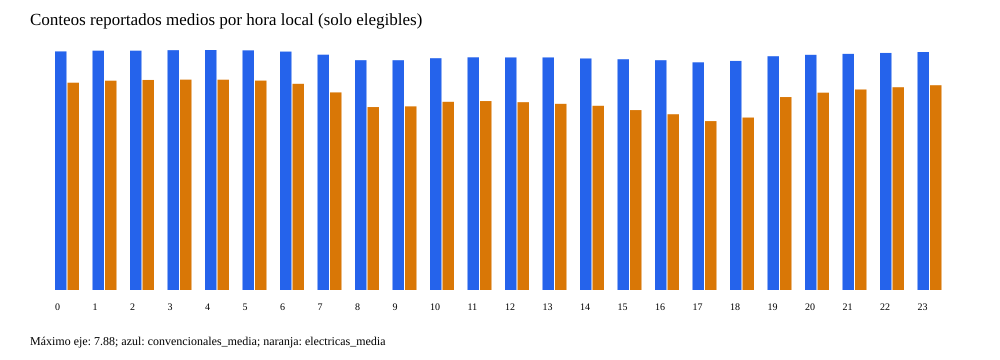
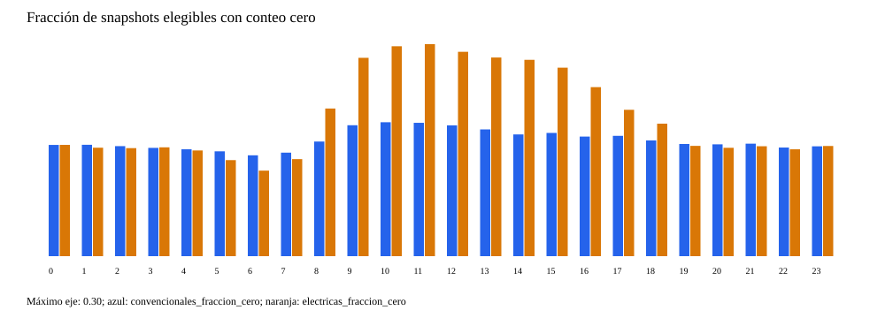
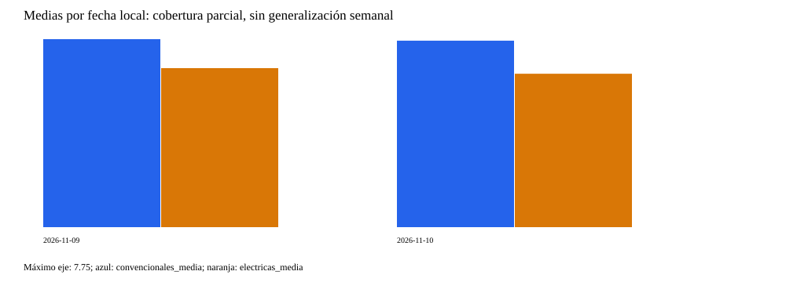

# Fase 4 — Gold de conteos reportados por tipo

> Antecedente de la prueba preliminar de un día. Los resultados ampliados se documentan en [reports/ampliacion](../ampliacion/metodologia.md); no sustituir sus cifras con las de este informe.
> El notebook principal se actualizó; la versión preliminar está [archivada](../../notebooks/archivo/00_prueba_preliminar_un_dia.ipynb).

## Estado verificado y alcance

Ejecución Gold `20261117T044523230826Z`, versión `gold-v1-conteos-reportados`. Se ejecutó en Docker PySpark 4.2.0 / Python 3.10.22. Solo se ejecutó la sección independiente Fase 4 del [notebook principal](../../notebooks/01_disponibilidad_batch.ipynb); se conservaron salidas anteriores. La prueba focalizada `tests/test_preparacion.py` pasó en ese mismo entorno. No se entrenó ni implementó U2.

El histórico **realmente procesado** sigue siendo 290 originales: 288 station_status, 1 station_information y 1 vehicle_types, todos del 2026-11-10 UTC. Las capturas cubren 00:00:02.493–23:55:01.713 UTC, equivalentes a 19:00 del 9–18:55 del 10 en America/New_York. No hay un día local completo ni observaciones de fin de semana.

El inventario previo registró 2.121 archivos remotos hasta el 16 de noviembre completo: 290 locales y 1.831 pendientes (~129 MB), con ~37,8 GB libres. La ampliación fue suspendida por instrucción del usuario; **no se incorporaron esos pendientes**. `reports/descargas/inventario_fase4.json` y `src/ampliacion.py` se conservan para después. No confundir fechas inventariadas con datos utilizados.

**Silver único de entrada:** `/opt/UNIDAD1/Dim-Disponibilidad/data/silver/20261117T040700694357Z`, versión `silver-v2-tipos-gbfs`, 707.762 aceptados + 17.944 excluidos = 725.706 observaciones. Ambos conjuntos pertenecen a esa misma ejecución; no se concatenaron versiones previas. Se verificaron los hashes de 290 raw y 16 partes Parquet antes y después.

## Significado del objetivo y cierre de fase 3

Los objetivos son conteos **reportados por tipo**, no cantidades físicas comprobadas. `vehicle_types_available` se elige porque permite declarar una representación uniforme por tipo resuelta mediante el catálogo local: ID 1=human, ID 2=electric_assist. No se elige porque el formato pruebe que es más exacta físicamente que la extensión `num_ebikes_available`. La documentación no arbitra esa diferencia. No se fuerza igualdad ni se reconstruyen convencionales por resta. Elegibilidad no garantiza exactitud. Véase el [cierre de fase 3](../calidad/reglas_y_hallazgos.md#cierre-de-fase-3-y-contrato-para-gold).

Gold conserva todas las columnas q_* iniciales y sus equivalentes f_q_* futuros, campos de origen, cantidades originales y las dos representaciones eléctricas. Los indicadores retrospectivos de variantes con igual last_reported y todos los campos futuros son solo auditoría, nunca predictores.

## Cobertura, calidad y exploración

Hay 2.520 estaciones con 234–288 capturas. La estación 2100948436010992354 tiene 234 capturas, de las cuales 163 son elegibles, y deja de aparecer tras 19:25 UTC. No se completan sus 54 ausencias finales. La mediana y P95 de capturas por estación elegible alcanzan 288; algunas estaciones tienen cero observaciones elegibles.

Cadencia: `{'delta_archivo_s_min': 295.93299984931946, 'delta_archivo_s_max': 304.2890000343323, 'delta_archivo_s_p50_p95': [300.07100009918213, 301.3619999885559], 'delta_feed_s_min': 284, 'delta_feed_s_max': 321, 'delta_feed_s_p50_p95': [300, 302]}`. Huecos interiores entre observaciones originales: `{'huecos_interiores_gt450s': 0, 'max_intervalo_s': 304.289}`. No se equipara ausencia al final con un hueco interior; los tramos de calidad se rompen también al aparecer observaciones no elegibles.

Las exclusiones Silver son 17.913 observaciones inactivas y 31 activas antiguas, conservadas en la entrada para que las variables no salten a través de ellas. Se mantienen 27.067 discrepancias originales entre suma por tipo y total. No se invalidan automáticamente por discrepar.

### Distribución de conteos elegibles

| Tipo | Observaciones | Media | Mediana | P95 | Máximo | Ceros | Estaciones con ceros |
|---|---:|---:|---:|---:|---:|---:|---:|
| convencionales | 707.762 | 7.698 | 5 | 25 | 82 | 116.812 | 1.096 |
| electricas | 707.762 | 6.371 | 3 | 24 | 98 | 141.408 | 1.835 |

Los cuantiles son aproximados. Cero es un conteo reportado, no una ausencia imputada.

### Hora y fecha local

Los gráficos usan como máximo 24 filas agregadas y no llevan el histórico a pandas:

| Fecha local / día ISO | Observaciones (incluye excluidas) | Media convencional elegible | Media eléctrica elegible |
|---|---:|---:|---:|
| 2026-11-09 / 1 | 151.200 | 7.747 | 6.554 |
| 2026-11-10 / 2 | 574.506 | 7.685 | 6.322 |

Las medias por hora/fecha son observaciones descriptivas de franjas diferentes, no efectos identificados del día de semana. La variable fin_semana es constante en este histórico. No se pueden concluir patrones semanales, estacionales ni causas de las diferencias horarias.

### Episodios reportados en cero

| Tipo | Episodios | Mediana de duración observada (s) | P95 (s) |
|---|---:|---:|---:|
| convencionales | 3.634 | 2100.7 | 53700.3 |
| electricas | 10.227 | 1199.9 | 17999.9 |

Son secuencias de snapshots elegibles con ceros y continuidad de calidad. Duración = último−primer timestamp observado, sin añadir un intervalo ni inventar el estado entre capturas. El JSON y notebook muestran cinco ejemplos por tipo; algunos cubren todos los snapshots del día. Esto no acredita ausencia física continua.

## Variables y prevención de fuga temporal

Hay **30 predictores numéricos deterministas** y station_id como categórica disponible:

- Por tipo: actual; lag5/lag10/lag15 y cambio5/cambio10/cambio15; media/min/max/desviación poblacional/número de muestras de los 15 minutos anteriores.
- Calendario local: hora, minuto, día ISO, fin de semana, seno y coseno de hora.

Los rezagos guardan también sus fechas reales. Las ventanas son estrictamente pasadas (excluyen la emisión), dentro de un tramo por tipo. Un salto >450 s o una observación no elegible rompe el tramo; los rezagos no lo atraviesan. No se rellenan ausencias con ceros. Un n15=0 describe ausencia de muestras, no cantidad de bicicletas.

La lista permitida está guardada en verificacion.json. No incluye f_*, y_*, estrato, motivos, segmentos, límites ni indicadores globales retrospectivos. Un entrenamiento que seleccione automáticamente todas las columnas numéricas violaría este contrato. No se aprenden imputadores, escaladores o codificadores aquí. Su eventual ajuste debe realizarse solo con entrenamiento.

No se incorporan metadatos de station_information. Así no se añade una capacidad o nombre actualizado después de la emisión ni se multiplica cardinalidad. La clasificación de los tipos es la convención semántica ya declarada en Silver, no una variable aprendida o un atributo futuro de estación.

### Historia insuficiente

| Variable (mismo conteo para ambos tipos) | Nulos entre ejemplos Gold |
|---|---:|
| lag5 | 7.634 |
| lag10 | 15.252 |
| lag15 | 22.861 |
| media15 | 7.634 |

Las cantidades actuales no tienen nulos en Gold. La historia inicial o posterior a una interrupción sí puede ser insuficiente. Estos ejemplos conservan etiquetas válidas; fase 5 debe elegir una política de nulos ajustada únicamente con train o un subconjunto de variables. No se ocultó esa decisión con imputación global.

## Emparejamiento de objetivos y cortes

El tiempo de emisión es captura_utc (convención del nombre de archivo), no last_reported. Se mantienen ambos relojes y last_updated para trazabilidad. Para cada horizonte se busca la captura más cercana a t+h dentro de ±30 s; empates favorecen la anterior. Se elige antes de evaluar calidad y no se busca otra etiqueta más conveniente. Se usa un equijoin con buckets temporales y banda residual; no lead por posición.

La tolerancia de 30 s es 10% de la cadencia observada de 300 s, holgada frente al jitter de pocos segundos y menor que media cadencia. Los objetivos futuros deben ser elegibles para su tipo y pertenecer al mismo tramo continuo que la emisión. Se guardan horizonte efectivo, error de emparejamiento, timestamp observado, archivo y motivos por objetivo.

| Partición | Emisiones UTC | Condición adicional del objetivo |
|---|---|---|
| train | inicio–antes de 16:00 | objetivo <16:00 |
| validacion | 16:00–antes de 20:00 | objetivo <20:00 |
| prueba | 20:00–fin del día | objetivo <2026-11-11 00:00 |

Las mismas fronteras se aplican a todas las estaciones y horizontes. Objetivos que tocan o cruzan el siguiente corte se purgan por horizonte. Una predicción en validación/prueba puede usar observaciones pasadas ya disponibles de períodos anteriores: es evaluación por emisión, sin usar futuros ni volver a ajustar parámetros.

## Conteos Gold reconciliados

Hay **2.177.118 candidatos = 725.706 × 3 horizontes**, 2.078.519 aceptados y 98.599 excluidos guardados con motivos. Gold es ancho, con dos etiquetas: sumar los conteos de ambos tipos duplicaría indebidamente el número de filas.

Las cifras siguientes son válidas **para cada uno de los dos tipos** por separado: en este día coinciden, aunque el código y las pruebas admiten elegibilidad distinta.

| Horizonte | Train aceptados | Validación aceptados | Prueba aceptados | Total aceptados | Total excluidos |
|---:|---:|---:|---:|---:|---:|
| 5 min | 469.669 | 115.267 | 115.361 | 700.297 | 25.409 |
| 10 min | 467.147 | 112.792 | 112.896 | 692.835 | 32.871 |
| 15 min | 464.635 | 110.321 | 110.431 | 685.387 | 40.319 |

Incidencias por motivo (por tipo; se solapan, no sumar como filas):

| Motivo | Incidencias |
|---|---:|
| objetivo_cruza_corte_temporal | 30.234 |
| inicial_no_elegible | 53.832 |
| objetivo_no_elegible | 53.495 |
| hueco_o_inactividad_en_trayecto | 54.036 |
| sin_captura_objetivo_en_tolerancia | 15.120 |

Cada candidato pertenece a un único conjunto aceptado/excluido. Las razones por tipo se conservan en arrays. El multiconjunto de aceptados ∪ excluidos coincide exactamente con los candidatos, incluidas multiplicidades y nulos.

### Horizontes reales verificados

| Horizonte nominal | Mínimo efectivo (s) | Máximo efectivo (s) | Error absoluto máximo (s) |
|---|---:|---:|---:|
| 5 min | 295.933 | 304.289 | 4.289 |
| 10 min | 595.783 | 603.683 | 4.217 |
| 15 min | 895.877 | 903.816 | 4.123 |

El último objetivo de train es 15:55:02.404 UTC, el de validación 19:55:02.041 y el de prueba 23:55:01.713. Ninguno alcanza el siguiente corte. El error máximo observado es inferior a 4,3 s, dentro de la banda de ±30 s.

## Contrato de evaluación de discrepancias para fase 5

Se conservarán las mismas predicciones de un modelo dado y se calcularán métricas por tipo, horizonte y split sobre: **todos**, **sin discrepancias**, **con discrepancias**. Un par pertenece a con_discrepancias si algún indicador inicial o futuro es verdadero; sin_discrepancias exige todos los indicadores conocidos y falsos. Los desconocidos se reportan aparte, incluidos en todos pero no convertidos a sin_discrepancias. No hay desconocidos elegibles en este día.

Los siguientes subconjuntos son iguales en número para ambos tipos en este histórico:

| Horizonte | Partición | Todos | Sin discrepancias | Con discrepancias |
|---|---|---:|---:|---:|
| 5 | train | 469.669 | 445.127 | 24.542 |
| 5 | validacion | 115.267 | 106.054 | 9.213 |
| 5 | prueba | 115.361 | 100.502 | 14.859 |
| 10 | train | 467.147 | 442.639 | 24.508 |
| 10 | validacion | 112.792 | 103.741 | 9.051 |
| 10 | prueba | 112.896 | 98.376 | 14.520 |
| 15 | train | 464.635 | 440.199 | 24.436 |
| 15 | validacion | 110.321 | 101.531 | 8.790 |
| 15 | prueba | 110.431 | 96.137 | 14.294 |

El estrato depende también de calidad futura y por ello se usa **después de predecir**, no como predictor ni selección de modelo a partir de prueba. No se entrenaron modelos ni se calcularon métricas predictivas en esta fase.

## Guardado y verificaciones

Salida en Docker: `/opt/UNIDAD1/Dim-Disponibilidad/data/gold/20261117T044523230826Z`; corresponde a `data/gold/20261117T044523230826Z/` de esta dimensión en el host. Se conserva la única fuente Silver indicada al comienzo.

- aceptados/ y excluidos/ están particionados por fecha UTC inicial y particion_temporal; no por estación. Horizonte permanece como columna. Se limita el tamaño por archivo a 250.000 filas.
- entradas.json guarda configuración, cortes, tolerancias, versiones y manifiesto con SHA-256 de originales y partes Silver. verificacion.json añade software, hashes del código, lista de features, conteos y EDA. Son artefactos locales ignorados por Git.
- La lectura de vuelta comprobó nombres/tipos del esquema, conteos y exceptAll en ambos sentidos; no se perdieron ni duplicaron candidatos. Parquet relaja nullability, que no se considera cambio de tipo.
- Se verificaron unicidad estación/captura/horizonte, límites efectivos, calidad del objetivo, continuidad del tramo y purga cronológica. Se verificó que cada timestamp de rezago preceda a la emisión.
- La prueba sintética comprueba captura ausente pese a existir una fila posterior, jitter temporal, huecos, calidad futura distinta por tipo, límites de train/validación/prueba y que perturbar un futuro no cambie las features anteriores.
- explain(formatted) y plan_fecha.txt muestran PartitionFilters para fecha_captura_utc y particion_temporal=train. Hay una fecha UTC y tres splits reales: no se presume una mejora de rendimiento no medida.
- Los 290 originales y las 16 partes Silver conservaron sus SHA-256. No se cambiaron Dockerfile ni Compose. No hubo commits ni push.

## Preparación para fase 5 y limitaciones

**Listo técnicamente para experimentos de fase 5**, con decisiones pendientes
explícitas: tratamiento de nulos de historia ajustado solo con train, modelos y
baselines, métricas estratificadas y evaluación frente a más días independientes.

No está validada la generalización diaria/semanal/estacional. Son menos de 24 horas
de captura, con lunes local parcial y martes parcial, sin fin de semana. El conjunto
de prueba ya fue inspeccionado en fases anteriores; sus resultados futuros serían
exploratorios, no una evaluación final intocada. Los splits cubren horarios distintos
y presentan posibles cambios de distribución. Muchas filas correlacionadas por
estación y entre horizontes no sustituyen días independientes.

El reloj de captura procede de una convención de nombres; no se ha auditado el
capturador externo. La exactitud física de las cantidades permanece sin confirmar.
Estos límites no se corrigen aumentando artificialmente filas, rellenando huecos o
forzando igualdad entre campos. Las series están preparadas para predecir lo
reportado, con su incertidumbre e indicadores conservados.
